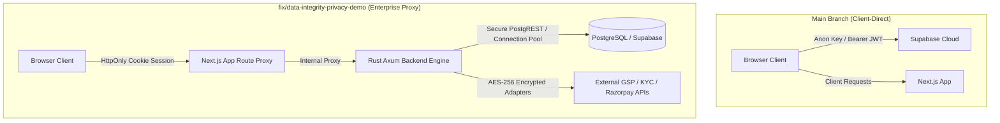

# Branch Comparison: `main` vs. `fix/data-integrity-privacy-demo`

*Generated on November 1, 2026*

This document provides a comprehensive structural, architectural, and functional comparison between **`main`** and **`fix/data-integrity-privacy-demo`** in Deku Finance.

---

## 1. Executive Summary

| Dimension | `main` | `fix/data-integrity-privacy-demo` |
| :--- | :--- | :--- |
| **Commit Delta** | Base tracking branch + UI dark theme commit (`71acf61`) | **Ahead by 50+ commits** (+42,177 lines, -18,036 lines across 327 files) |
| **Primary Focus** | UI dark mode, horizontal Tally-style TopBar, Gateway dashboard | **Production-grade ERP platform overhaul**, data integrity, self-hosted auth, enterprise compliance, and business workflows |
| **Auth Architecture** | Direct client-side Supabase JS (`@supabase/supabase-js`) | **Self-hosted cookie sessions via Rust backend proxy**; dropped raw client-side Supabase tokens |
| **Database Migrations** | 17 base migrations | **44 total migrations** (+27 production migrations including FIFO, approvals, business docs, GSP/KYC) |
| **Navigation Shell** | Horizontal Tally-style `TopBar` | Persistent left `AppSidebar` with category trees + Notification Bell + Shortcut strip |
| **Data Integrity** | Reports mixed real ledger data with mock fallback metrics | **100% authoritative PostgreSQL ledger functions**; zero fabricated data; closed tenant-isolation holes |
| **Deployment / CI** | Standard dev server | **Docker multi-stage builds**, `docker-compose.yml`, GCP Cloud Build pipeline, and SQL test suites |

---

## 2. Architecture & Security Differences



### Authentication & Sessions
- **`main`**: The browser talks directly to Supabase using public API keys. Auth state is stored in localStorage/client cookies, exposing session tokens to XSS risks.
- **`fix/data-integrity-privacy-demo`**: Replaced client-side token access with **HTTP-only secure cookies**. All requests pass through a same-origin proxy (`/api/backend/*`) handled by the Rust backend (`backend/src/auth.rs`), eliminating credential leaks.

### Data Privacy & Tenant Boundaries
- **`main`**: Basic row-level security (RLS) on core tables, but cross-company reporting gaps existed in custom views.
- **`fix/data-integrity-privacy-demo`**: Hardened multi-tenant boundaries (`20261028000018` & `20261028000022`). Enforced strict RLS across licenses, payroll, inventory, and ledger functions with automated tenant leakage verification tests.

---

## 3. Database & Migrations Comparison

The `fix/data-integrity-privacy-demo` branch introduces **27 new database migrations** that expand Deku Finance from a ledger prototype into a full accounting ERP:

| Migration Range | File / Module | Core Functionality Added |
| :--- | :--- | :--- |
| **M18 – M20** | `20261028000018` – `20` | **Security lockdown**, **Bank Reconciliation** schema, and **Maker-Checker Voucher Approvals** |
| **M21 – M23** | `20261028000021` – `23` | **Reversed entry handling** in reports; authoritative Working Capital (WCM) & FP&A SQL |
| **M24 – M25** | `20261028000024` – `25` | **Purchase Bill Register** with ITC eligibility tracking + Sales invoice channel classification |
| **M26 – M29** | `20261031000026` – `29` | Journal reversal guards, GST return filing tracking, and real-time ledger aggregate functions |
| **M30 – M33** | `20261031000030` – `33` | Company profile onboarding, **Credit/Debit Notes (GSTR-1 9B)**, Invoice types, and **HSN/SAC master** |
| **M34 – M36** | `20261031000034` – `36` | **In-app notifications**, **Marketplace settlements** (Amazon/Flipkart), and **Razorpay OAuth payment links** |
| **M37 – M40** | `20261031000037` – `40` | GSP API adapters, automated KYC verification, subscriptions/seat limiting, and invoice status guards |
| **M41** | `20261031000041` | **Membership bootstrap fix** (resolves org creation permissions) + Marketplace clearing accounts |
| **M42** | `20261031000042` | **FIFO Inventory Valuation**: Real-time stock ledgers computed directly inside Postgres |
| **M43** | `20261031000043` | **Tally XML / CSV Import Engine**: Background job processing with error rollups |
| **M44** | `20261031000044` | **Business Document Builder**: Quotes, POs, Delivery Challans saved in DB with invoice conversion |

---

## 4. Feature & Functional Matrix

| Feature | `main` | `fix/data-integrity-privacy-demo` |
| :--- | :---: | :---: |
| **Double-Entry Journal & Day Book** | Yes | Yes (enhanced with approval states) |
| **Maker-Checker Voucher Approvals** | No | **Yes** (`/approvals` workflow) |
| **Bank Reconciliation & Statement Parser** | Mock / Prototype | **Yes** (In-browser CSV/MT940 parser + auto-matcher) |
| **Purchase Bill Register & ITC (GSTR-3B T4)** | Basic | **Yes** (Eligible vs. Ineligible ITC classification) |
| **Sales Invoicing & E-Invoicing Prep** | Basic Editor | **Yes** (IRN/QR prep, custom invoice types, notes) |
| **Credit / Debit Notes Engine** | No | **Yes** (Linked to GSTR-1 Table 9B) |
| **Business Document Builder** | Client-only drafts | **Yes** (Postgres-stored quotes, POs, and challans) |
| **Quote-to-Invoice Conversion** | No | **Yes** (1-click draft invoice generation) |
| **FIFO Stock & Inventory Valuation** | No | **Yes** (Document-driven movements in SQL) |
| **Tally XML / CSV Importer** | No | **Yes** (Import masters and vouchers from Tally) |
| **Marketplace Settlement Reconciliation** | No | **Yes** (Amazon/Flipkart clearing account journals) |
| **Payment Links (Razorpay)** | No | **Yes** (Company-owned Razorpay account links) |
| **In-App Notification Bell** | No | **Yes** (Background event scheduler + bell UI) |
| **GSP & KYC Adapter Hub** | No | **Yes** (Pluggable adapters for GST and PAN/Bank KYC) |
| **Legacy `/dashboard/*` Routes** | Partially active | **Fully cleaned and redirected** to modern routes |

---

## 5. UI, Design System & Theming

### `main`
- Uses horizontal top navigation bar (`TopBar.tsx`).
- Centered on a 3-column Tally-like gateway layout.
- Features the **Deku Dark Theme** with custom dark tokens (`#101820`, `#162521`, `#202D35`) and an interactive dark/light toggle in user settings.

### `fix/data-integrity-privacy-demo`
- Uses modern SaaS vertical navigation (`AppSidebar.tsx`) with collapsible sections and global shortcut footer (`ShortcutBar.tsx`).
- Uses semantic design tokens defined in `globals.css` (`--color-canvas`, `--color-surface`, `--color-ink`, `--color-brand`, `--color-panel`).
- Includes narrow-screen table scrolling, responsive cards, and clean typography.
- Retired old mock `/dashboard/*` pages and replaced them with unified `/gst/returns`, `/gst/file`, `/gateway`, and `/settings` pages.

---

## 6. Testing, CI/CD & Infrastructure

```
                      +---------------------------------------+
                      |               Test Harness            |
                      +---------------------------------------+
                      |  main: 4 unit test files              |
                      |  fix:  30+ Vitest files + pgTAP tests |
                      +---------------------------------------+
                                          |
                                          v
                      +---------------------------------------+
                      |           Docker & Deployment         |
                      +---------------------------------------+
                      |  main: No Docker / Compose config     |
                      |  fix:  Multi-stage Next + Rust backend|
                      |        Docker-compose + GCP CloudBuild|
                      +---------------------------------------+
```

1. **Unit & Integration Tests**:
   - `main`: 4 basic frontend unit tests.
   - `fix/data-integrity-privacy-demo`: Comprehensive testing suite covering financial calculations, GST returns, HSN search, inventory movements, session expiration, and tenant security.
2. **Database Test Suite**:
   - Includes `supabase/tests/run_local.sh` and 15 SQL test files verifying migrations, triggers, and accounting constraints.
3. **Containerization & GCP Cloud Build**:
   - Production multi-stage `Dockerfile` (Rust binary + standalone Next.js 16 build).
   - `docker-compose.yml` defining PostgreSQL, PostgREST, Rust backend, and Next.js frontend.
   - Ready-to-deploy Google Cloud Platform deployment scripts (`deploy/gcp/cloudbuild.yaml`).

---

## 7. Recommendation: Merging Strategy

Because `fix/data-integrity-privacy-demo` represents a generational platform leap (+42,000 lines, self-hosted backend, 27 migrations, and full ERP functionality) while `main` contains the refined dark theme styling (`71acf61`), the recommended approach is:

1. **Keep `fix/data-integrity-privacy-demo` as the core operational codebase** for backend, database, and feature development.
2. When ready to merge into `main`:
   - Fast-forward or merge `fix/data-integrity-privacy-demo` into `main`.
   - Port any remaining dark-palette aesthetic preferences from `main` into the semantic tokens of the new design system.

