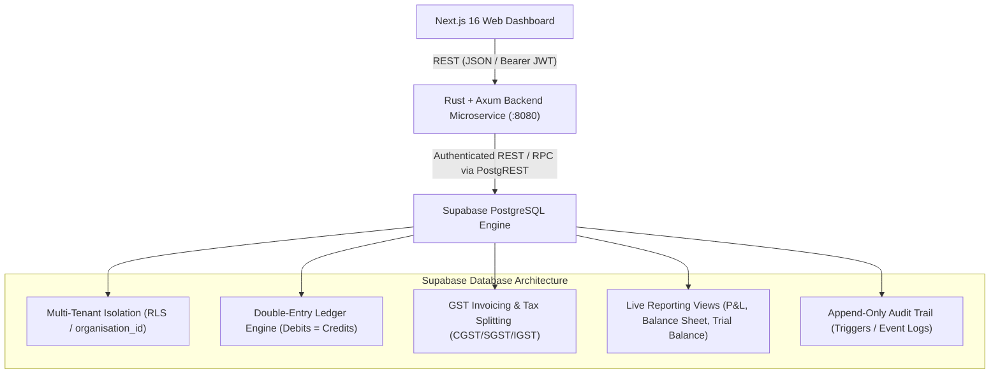

# Deku Finance — Database Schema & Rust Microservice API Architecture

> **Complete Reference Guide**: Database foundation, tenant isolation, double-entry ledger engine, GST compliance, and Rust/Axum API endpoints.

---

## 1. System Architecture Overview



---

## 2. Database Schema Reference

The database consists of **13 relational tables**, **4 financial views**, and **7 security-definer stored procedures (RPCs)** partitioned across 10 sequential migrations.

### Core Relational Tables

| # | Table Name | Migration | What It Does | What It Stores | How APIs Connect To It |
|---|---|---|---|---|---|
| **1** | `profiles` | `000001` | Manages global user identities synced from Supabase Auth (`auth.users`). | `id` (FK to auth), `email`, `full_name`, `avatar_url`, `created_at` | Queried automatically by member listings; linked to JWT `sub`. |
| **2** | `organisations` | `000002` | Root tenant entity. Isolates all data, books of accounts, and invoices. | `id`, `name`, `slug`, `legal_name`, `gstin`, `pan`, `currency`, `timezone`, `fy_start_month` | `POST /api/v1/organisations`<br>`GET /api/v1/organisations/:id` |
| **3** | `organisation_members` | `000002` | Role-based access control (RBAC) mapping users to organizations. | `id`, `organisation_id`, `user_id`, `role` (`owner`, `admin`, `accountant`, `member`, `viewer`) | `GET /api/v1/organisations/:id/members`<br>Queried by `has_role()` RLS helper. |
| **4** | `parties` | `000003` | Master registry for Customers, Vendors, and Both. | `id`, `organisation_id`, `type`, `legal_name`, `display_name`, `gstin`, `pan`, `billing_address`, `shipping_address`, `email`, `phone` | `POST /api/v1/organisations/:org_id/parties`<br>`GET /api/v1/organisations/:org_id/parties` |
| **5** | `catalogue_items` | `000004` | Product & Service catalog with GST rates and HSN/SAC codes. | `id`, `organisation_id`, `type` (`good`/`service`), `name`, `sku`, `hsn_sac_code`, `unit_price`, `gst_rate`, `cess_rate` | `POST /api/v1/organisations/:org_id/catalogue`<br>`GET /api/v1/organisations/:org_id/catalogue` |
| **6** | `accounts` | `000005`, `000011` | Chart of Accounts (COA) structured strictly via the 4-tier ALERX model (Group -> Ledger -> Sub-Ledger -> Label -> Unit). | `id`, `organisation_id`, `code`, `name`, `account_group` (`asset`, `liability`, `equity`, `revenue`, `expense`), `ledger`, `sub_ledger`, `label`, `is_postable`, `unit_name` | `GET /api/v1/organisations/:org_id/accounts`<br>`POST /api/v1/organisations/:org_id/accounts/seed` |
| **7** | `fiscal_periods` | `000005` | Accounting periods governing when transactions can be posted. | `id`, `organisation_id`, `name` (e.g. `FY 2026-27`), `start_date`, `end_date`, `status` (`open`, `closed`, `locked`) | `POST /api/v1/organisations/:org_id/fiscal-periods`<br>`GET /api/v1/organisations/:org_id/fiscal-periods` |
| **8** | `journal_entries` | `000006` | Header for double-entry transactions (General Journal). | `id`, `organisation_id`, `fiscal_period_id`, `entry_number`, `entry_date`, `status` (`draft`, `posted`, `reversed`), `narration`, `reference` | `POST /api/v1/organisations/:org_id/journals`<br>`GET /api/v1/organisations/:org_id/journals` |
| **9** | `journal_entry_lines` | `000006`, `000011` | Line items debited or credited against accounts. Guard trigger enforces posting ONLY to Labels. | `id`, `organisation_id`, `journal_entry_id`, `line_number`, `account_id`, `party_id`, `description`, `debit`, `credit` | Created atomically via `create_journal` and `issue_sales_invoice`. |
| **10** | `sales_invoices` | `000007`, `000010` | GST compliant sales invoice headers with intra/inter-state tax totals. | `id`, `organisation_id`, `customer_id`, `invoice_number`, `invoice_date`, `due_date`, `supply_type`, `place_of_supply`, `taxable_amount`, `cgst_amount`, `sgst_amount`, `igst_amount`, `total_amount`, `status`, `journal_entry_id` | `POST /api/v1/organisations/:org_id/invoices`<br>`GET /api/v1/organisations/:org_id/invoices`<br>`POST /:id/issue`, `POST /:id/cancel` |
| **11** | `sales_invoice_lines` | `000007` | Line items for invoices detailing items, HSN codes, and tax rates. | `id`, `organisation_id`, `invoice_id`, `catalogue_item_id`, `hsn_sac_code`, `quantity`, `unit_price`, `taxable_amount`, `gst_rate`, `cgst_amount`, `sgst_amount`, `igst_amount`, `total_amount` | Created during `create_invoice`, validated and sealed by `issue_sales_invoice`. |
| **12** | `invoice_documents` | `000008` | Document metadata and storage pointers for invoice PDFs/receipts. | `id`, `organisation_id`, `invoice_id`, `category` (`pdf`, `supporting_doc`, `e_way_bill`), `storage_path`, `file_name`, `file_size_bytes` | Queried by document management endpoints. |
| **13** | `audit_events` | `000009` | Immutable tamper-evident audit trail capturing every system event. | `id`, `organisation_id`, `actor_id`, `action`, `entity_type`, `entity_id`, `metadata`, `ip_address`, `created_at` | `GET /api/v1/organisations/:org_id/audit-events`<br>Populated automatically via triggers & RPC. |

---

### 2.1 The ALERX 4-Tier Hierarchy, State Change Units & Monetary Value

The Chart of Accounts follows the **ALERX** framework (Assets, Liabilities, Equity, Revenue, Expense):

```
COA Account Group (ALERX) ──► Ledger ──► Sub-Ledger ──► Label (Transacting Entity) ──► Unit (State Change) & Value (INR)
```

1. **COA Account Group (ALERX)**: The 5 macro accounting classifications:
   - **A** — Assets (`asset`)
   - **L** — Liabilities (`liability`)
   - **E** — Equity (`equity`)
   - **R** — Revenue (`revenue`)
   - **X** — Expenses (`expense`)
2. **Ledger**: Major functional classification (e.g. `Cash & Liquid Capital`, `Current Assets & Receivables`, `Statutory & Tax Liabilities`).
3. **Sub-Ledger**: Specific control category (e.g. `Operating Bank Accounts`, `Trade Debtors`, `Output GST Control`).
4. **Label**: The concrete transacting leaf account (e.g. `HDFC Bank Current Account`, `Primary Shareholder Capital`).
   > **Enforced Rule**: Double-entry journal transactions can **only occur between Labels** (`is_postable = true`). Parent ledgers and groups cannot be posted to directly.
5. **Unit (State Change)**: The discrete count of state-change events / voucher records applied to that Label.
6. **Value (Monetary Magnitude)**: The net financial value (in INR or base currency) resulting from those state-change transactions.

#### Concrete Examples:

- **Founder Capital Infusion (Owner adds 2.5L once)**:
  `Equity` (Group) ──► `Owner / Contributed Capital` (Ledger) ──► `Shareholder Capital` (Sub-Ledger) ──► `Primary Shareholder Capital` (Label) ──► **`Unit: 1`** | **`Value: Rs. 2,50,000.00`**
  *(Unit is 1 because the owner executed 1 state change, and the value of that state change was Rs. 2.5L).*

- **Operating Bank Deposit (HDFC Bank receives 2.5L once)**:
  `Assets` (Group) ──► `Cash & Liquid Capital` (Ledger) ──► `Operating Bank Accounts` (Sub-Ledger) ──► `HDFC Bank Current Account` (Label) ──► **`Unit: 1`** | **`Value: Rs. 2,50,000.00`**

- **Customer Sales Invoiced (1 invoice issued)**:
  `Assets` (Group) ──► `Current Assets & Receivables` (Ledger) ──► `Trade Debtors` (Sub-Ledger) ──► `Customer Trade Receivables` (Label) ──► **`Unit: 1`** | **`Value: Rs. 1,18,000.00`**

- **Subsequent Transactions on Same Label**:
  If the owner adds another Rs. 1,00,000 later, **Unit becomes 2** (2nd state change) and **Value becomes Rs. 3,50,000.00**.

---

### Financial Reporting Views

| View Name | What It Does / Computes | Underlying Sources | Connected API Endpoint |
|---|---|---|---|
| `view_general_ledger` | Unfolds posted journal entries with line details, ALERX classifications, account codes, and party names. | `journal_entries`<br>`journal_entry_lines`<br>`accounts`, `parties` | `GET /api/v1/organisations/:org_id/reports/general-ledger` |
| `view_account_balances` | Aggregates all debit and credit movements per Label into current net unit balances (e.g. 250,000) structured by ALERX Group -> Ledger -> Sub-Ledger -> Label. | `journal_entries`<br>`journal_entry_lines`<br>`accounts` | `GET /api/v1/organisations/:org_id/reports/account-balances` |
| `view_profit_and_loss` | Summarizes revenue and expense balances to calculate gross profit, operating expenses, and net profit/loss. | `journal_entries`<br>`journal_entry_lines`<br>`accounts` | `GET /api/v1/organisations/:org_id/reports/profit-and-loss` |
| `view_balance_sheet` | Aggregates Assets, Liabilities, and Equity accounts with live calculated retained earnings. | `journal_entries`<br>`journal_entry_lines`<br>`accounts` | `GET /api/v1/organisations/:org_id/reports/balance-sheet` |

---

### Stored Procedures & Business Logic RPCs

| RPC Name | Purpose & Business Rules | Security & Immutability |
|---|---|---|
| `create_organisation()` | Atomically provisions a new tenant and assigns the authenticated creator as `'owner'`. | `SECURITY DEFINER` |
| `seed_default_chart_of_accounts()` | Populates standard Indian GAAP 25-account structure (Assets: 1000s, Liabilities: 2000s, Equity: 3000s, Revenue: 4000s, Expenses: 5000s). | Idempotent |
| `post_journal_entry()` | Validates fiscal period is open, validates `SUM(debit) = SUM(credit) > 0`, and seals entry as `'posted'` (strictly immutable). | Immutability Trigger Guarded |
| `reverse_journal_entry()` | Generates a mirror reversal entry (swapping debits and credits) and transitions original status to `'reversed'`. | Audit Tracked |
| `issue_sales_invoice()` | Validates GST line splits (CGST=SGST for intra-state, IGST for inter-state), synchronizes totals, generates balanced AR/Sales/Tax journal entry, and marks `'issued'`. | Atomic Execution |
| `cancel_sales_invoice()` | Cancels an issued invoice and automatically generates an accounting reversal entry for its linked journal. | Reversal Linked |
| `record_audit_event()` | Inserts append-only event into `audit_events`. | Unmodifiable |

---

## 3. Comprehensive Rust Microservice API Reference

The Rust backend runs on **port 8080** using Axum, Tokio, and Reqwest with Tower tracing and CORS support.

### Module 1: System Health & Diagnostics

| Method | Endpoint URI | Connected DB Object | Purpose & Use Case | Triggered By (Frontend Action) |
|---|---|---|---|---|
| `GET` | `/health` | None | Liveness and health check probe. | Monitored by container orchestrator or dashboard status indicator. |

---

### Module 2: Organisations & Multi-Tenancy

| Method | Endpoint URI | Connected DB Object | Purpose & Use Case | Triggered By (Frontend Action) |
|---|---|---|---|---|
| `POST` | `/api/v1/organisations` | `create_organisation()` RPC | Creates a new tenant organization and assigns current user as `'owner'`. | Triggered when user completes the "Create Organization" onboarding modal. |
| `GET` | `/api/v1/organisations` | `organisations` table | Lists organizations where user is an active member. | Triggered on app load / organization switcher dropdown. |
| `GET` | `/api/v1/organisations/:id` | `organisations` table | Fetches organization settings, GSTIN, currency, and timezone. | Triggered on navigating to "Settings > Company Profile". |
| `GET` | `/api/v1/organisations/:id/members` | `organisation_members` + `profiles` | Lists team members and their roles (`admin`, `accountant`, etc.). | Triggered on navigating to "Settings > Team & Access". |

---

### Module 3: Parties & Master Data

| Method | Endpoint URI | Connected DB Object | Purpose & Use Case | Triggered By (Frontend Action) |
|---|---|---|---|---|
| `POST` | `/api/v1/organisations/:org_id/parties` | `parties` table | Creates a Customer, Vendor, or Both with GSTIN validation. | Triggered when user submits the "New Customer" or "New Vendor" form. |
| `GET` | `/api/v1/organisations/:org_id/parties` | `parties` table | Lists all customers and vendors with address and contact details. | Triggered on loading the "Customers" or "Vendors" directory views. |
| `GET` | `/api/v1/organisations/:org_id/parties/:party_id` | `parties` table | Fetches single party profile and transaction history. | Triggered when clicking a specific customer row in the directory. |

---

### Module 4: Product & Service Catalogue

| Method | Endpoint URI | Connected DB Object | Purpose & Use Case | Triggered By (Frontend Action) |
|---|---|---|---|---|
| `POST` | `/api/v1/organisations/:org_id/catalogue` | `catalogue_items` table | Creates a product or service with unit price, HSN/SAC code, and GST rate. | Triggered when user saves a product in the "Items / Catalogue" screen. |
| `GET` | `/api/v1/organisations/:org_id/catalogue` | `catalogue_items` table | Retrieves catalog items for inventory browsing and invoice line auto-fill. | Triggered when typing into the "Select Item" dropdown on invoice creation. |

---

### Module 5: Chart of Accounts & Fiscal Periods

| Method | Endpoint URI | Connected DB Object | Purpose & Use Case | Triggered By (Frontend Action) |
|---|---|---|---|---|
| `GET` | `/api/v1/organisations/:org_id/accounts` | `accounts` table | Retrieves full Chart of Accounts tree sorted by code (`1000`–`5000`). | Triggered on loading the "Accounting > Chart of Accounts" screen. |
| `POST` | `/api/v1/organisations/:org_id/accounts/seed` | `seed_default_chart_of_accounts()` RPC | Initializes standard 25 Indian GAAP accounts for fresh organizations. | Triggered via "Initialize Default Chart of Accounts" setup prompt. |
| `POST` | `/api/v1/organisations/:org_id/fiscal-periods` | `fiscal_periods` table | Opens a new fiscal period (e.g. `FY 2026-27`). | Triggered when user clicks "Open New Financial Year" in Settings. |
| `GET` | `/api/v1/organisations/:org_id/fiscal-periods` | `fiscal_periods` table | Lists all fiscal periods and their current status (`open`/`closed`). | Triggered on the Fiscal Year management screen and entry date pickers. |

---

### Module 6: Double-Entry Journal & Ledger Posting

| Method | Endpoint URI | Connected DB Object | Purpose & Use Case | Triggered By (Frontend Action) |
|---|---|---|---|---|
| `POST` | `/api/v1/organisations/:org_id/journals` | `journal_entries` + `journal_entry_lines` | Creates a draft journal entry with multiple debit/credit lines. | Triggered when user clicks "Save as Draft" in the Manual Journal modal. |
| `GET` | `/api/v1/organisations/:org_id/journals` | `journal_entries` table | Lists journal entries with status filter (`draft`, `posted`, `reversed`). | Triggered on loading the "Journal Entries" register page. |
| `POST` | `/api/v1/organisations/:org_id/journals/:entry_id/post` | `post_journal_entry()` RPC | Atomically validates balanced totals and seals entry into general ledger. | Triggered when user clicks "Post Entry" on a draft journal review drawer. |
| `POST` | `/api/v1/organisations/:org_id/journals/:entry_id/reverse` | `reverse_journal_entry()` RPC | Creates and posts an exact debit/credit mirror reversal entry. | Triggered when user clicks "Reverse Journal Entry" with a reversal reason. |

---

### Module 7: GST Sales Invoicing

| Method | Endpoint URI | Connected DB Object | Purpose & Use Case | Triggered By (Frontend Action) |
|---|---|---|---|---|
| `POST` | `/api/v1/organisations/:org_id/invoices` | `sales_invoices` + `sales_invoice_lines` | Creates a draft sales invoice with line items, tax split, and totals. | Triggered when user clicks "Save Invoice Draft" on the Invoicing screen. |
| `GET` | `/api/v1/organisations/:org_id/invoices` | `sales_invoices` table | Lists invoices with status badge, customer name, date, and total. | Triggered on loading the "Sales Invoices" main dashboard view. |
| `GET` | `/api/v1/organisations/:org_id/invoices/:inv_id` | `sales_invoices` + lines | Fetches full invoice with line item breakdown and linked journal. | Triggered when clicking an invoice row to open the details view. |
| `POST` | `/api/v1/organisations/:org_id/invoices/:inv_id/issue` | `issue_sales_invoice()` RPC | Validates GST parity, issues invoice, and auto-posts balanced ledger journal. | Triggered when user clicks "Issue & Send Invoice". |
| `POST` | `/api/v1/organisations/:org_id/invoices/:inv_id/cancel` | `cancel_sales_invoice()` RPC | Cancels invoice and reverses linked ledger journal automatically. | Triggered when user confirms "Cancel Invoice" modal with reason. |

---

### Module 8: Live Financial Reports & Business Intelligence

| Method | Endpoint URI | Connected DB Object | Purpose & Use Case | Triggered By (Frontend Action) |
|---|---|---|---|---|
| `GET` | `/api/v1/organisations/:org_id/reports/general-ledger` | `view_general_ledger` | Detailed transaction report showing every account debit and credit. | Triggered when user navigates to "Reports > General Ledger". |
| `GET` | `/api/v1/organisations/:org_id/reports/account-balances` | `view_account_balances` | Real-time trial balance showing net balances across all accounts. | Triggered when user opens "Reports > Trial Balance". |
| `GET` | `/api/v1/organisations/:org_id/reports/profit-and-loss` | `view_profit_and_loss` | Live P&L showing Revenue, Expenses, Gross Profit, and Net Profit. | Triggered on the "Reports > Profit & Loss" page and Executive Dashboard cards. |
| `GET` | `/api/v1/organisations/:org_id/reports/balance-sheet` | `view_balance_sheet` | Live Balance Sheet showing Assets, Liabilities, and Equity. | Triggered on the "Reports > Balance Sheet" page and CFO Overview widget. |

---

### Module 9: Audit Trail & Security Governance

| Method | Endpoint URI | Connected DB Object | Purpose & Use Case | Triggered By (Frontend Action) |
|---|---|---|---|---|
---

### Module 10: Departments, Firm Members, Owner Access Governance & Payroll

| Method | Endpoint URI | Connected DB Object | Purpose & Use Case | Triggered By (Frontend Action) |
|---|---|---|---|---|
| `GET` | `/api/v1/organisations/:org_id/departments` | `departments` + tasks | Lists all departments with allocated vs utilized budget, lead info, and tasks. | Triggered on loading "Departments & Tasks" tab on `/departments-members`. |
| `POST` | `/api/v1/organisations/:org_id/departments` | `departments` table | Creates a new department with budget and code (Owner-only privilege). | Triggered when Owner clicks "Create Department" in modal. |
| `PATCH` | `/api/v1/organisations/:org_id/departments/:dept_id` | `departments` table | Updates department budget, lead person, or description. | Triggered when updating department metadata. |
| `DELETE` | `/api/v1/organisations/:org_id/departments/:dept_id` | `departments` table | Removes a department from the organisation hierarchy. | Triggered on confirming department removal. |
| `POST` | `/api/v1/organisations/:org_id/departments/:dept_id/tasks` | `department_tasks` | Logs intra-departmental or cross-departmental task with due date & priority. | Triggered when clicking "+ Add Task" on any department card. |
| `PATCH` | `/api/v1/organisations/:org_id/departments/:dept_id/tasks/:task_id` | `department_tasks` | Advances task workflow status (Todo -> In Progress -> Review -> Completed). | Triggered by clicking task status button directly on card. |
| `GET` | `/api/v1/organisations/:org_id/members` | `employees` + `departments` | Lists all firm personnel with department assignments, platform roles & CTC. | Triggered on opening "Members & Roles" tab. |
| `POST` | `/api/v1/organisations/:org_id/members` | `employees` table | Onboards a new firm employee and assigns them to a department (Owner-only). | Triggered via "+ Add Employee" modal. |
| `PATCH` | `/api/v1/organisations/:org_id/members/:member_id/permissions` | `update_employee_permissions()` RPC | Modifies selective platform access toggles (Vouchers, Banking, Reports, GST). | Triggered when Owner saves changes in "Configure Access" modal. |
| `PATCH` | `/api/v1/organisations/:org_id/members/:member_id/compensation` | `employees` table | Updates CTC, monthly gross, statutory TDS/EPF deductions, and bank details. | Triggered in personal compensation management view. |
| `POST` | `/api/v1/organisations/:org_id/members/:member_id/bonus` | `grant_employee_bonus()` RPC | Accrues performance bonus incentive directly to employee ledger. | Triggered when clicking "Grant Bonus" in Payroll tab. |
| `POST` | `/api/v1/organisations/:org_id/members/:member_id/reimbursements/approve` | `approve_employee_reimbursement()` RPC | Approves pending reimbursement expense claim and updates employee balance. | Triggered by 1-click "Approve" button on reimbursement row. |
| `POST` | `/api/v1/organisations/:org_id/payroll/run` | `run_monthly_payroll()` RPC | Executes firm-wide monthly payroll batch, locks salaries, and records run. | Triggered by "Run Monthly Payroll Batch" button. |
| `GET` | `/api/v1/organisations/:org_id/payroll/runs` | `payroll_runs` table | Lists chronological payroll disbursement records. | Triggered when inspecting payroll history audit. |

---

## 4. End-to-End Workflow Diagram

```
[User Action]
   │
   ├── 1. POST /organisations ──────────► creates tenant & assigns Owner
   ├── 2. POST /accounts/seed ──────────► seeds 25 Indian GAAP Chart of Accounts
   ├── 3. POST /fiscal-periods ─────────► opens FY 2026-27
   ├── 4. POST /parties ────────────────► registers Customer with GSTIN
   ├── 5. POST /catalogue ──────────────► creates Item with 18% GST & SAC Code
   ├── 6. POST /departments ────────────► creates Department (Finance & Accounts, MGMT, etc.)
   ├── 7. POST /members ────────────────► onboards Employee assigned to Department
   ├── 8. PATCH /members/:id/permissions► Owner assigns selective module access
   ├── 9. POST /payroll/run ────────────► executes monthly payroll batch & TDS/EPF deductions
   ├── 10. POST /invoices ──────────────► creates Draft Sales Invoice
   │
   └── 11. POST /invoices/:id/issue ────► [issue_sales_invoice() RPC]
                                            │
                                            ├── Validates intra-state tax parity (CGST = SGST = 9%)
                                            ├── Generates balanced Journal Entry (Debit AR, Credit Revenue & Output Taxes)
                                            ├── Calls post_journal_entry() -> marks entry 'posted'
                                            ├── Seals invoice status to 'issued'
                                            └── Links journal_entry_id to invoice atomically
                                            │
   ┌────────────────────────────────────────┘
   ▼
[Live Financial Reports View Query]
   ├── GET /reports/profit-and-loss ───► Reflects new Rs. 100,000 Revenue
   └── GET /reports/balance-sheet ─────► Reflects Rs. 118,000 AR & Rs. 18,000 Output Tax Liability
```
