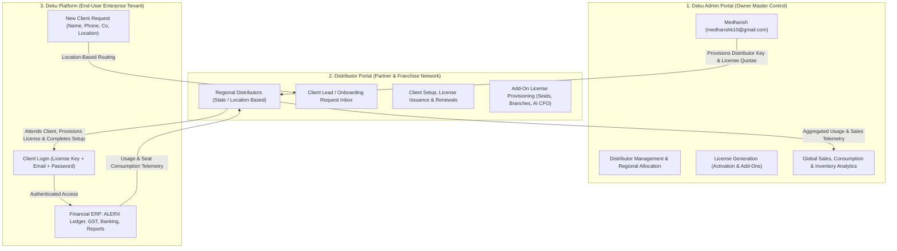

# Deku Finance · 3-Tier Commercial Ecosystem Architecture

This document specifies the target commercial, operational, and licensing architecture for Deku Finance, organized into **three distinct interfaces**:



---

## 1. The Three Interfaces

### Interface 1: Deku Admin (Super Admin Control)
- **Primary Operator**: Medhansh (`medhanshk10@gmail.com`) exclusively.
- **Access Route**: `/admin` (protected by superadmin role gate & email lock).
- **Core Capabilities**:
  1. **Distributor Management**:
     - Onboard new distributors, assign geographical territory (State, Region, Pin Code ranges).
     - Issue **Distributor Master Credentials & Licenses**.
     - Set distributor discount tiers, credit limits, and activation quotas.
  2. **License Inventory & Generation**:
     - Generate **Activation Licenses** (e.g., `DEKU-GO-2026-XXXX`, `DEKU-PRO-2026-XXXX`, `DEKU-ENT-2026-XXXX`).
     - Generate **Add-On Licenses** (Additional Seats, Extra Godowns, AI CFO Module, Multi-GSTIN).
     - Allocate batches of activation keys to distributors.
     - Revoke, freeze, or extend any license globally.
  3. **Global Analytics & Revenue**:
     - Real-time global dashboard: Total licenses issued, allocated, active, and expired.
     - Sales tracking per distributor, renewal rates, and regional consumption.

---

### Interface 2: Distributor Portal (Partner Network)
- **Primary Operators**: Authorized regional distributors and franchise partners.
- **Access Route**: `/distributor` (authenticated via distributor license credentials).
- **Core Capabilities**:
  1. **Inbound Client Request Inbox**:
     - Automatically receives new prospective client leads based on location routing (State / City / Pin Code).
     - Status tracker: `New Lead` ➔ `Contacted` ➔ `Setup in Progress` ➔ `License Issued` ➔ `Live`.
  2. **Client Setup & Onboarding**:
     - Distributor attends to the client, performs initial company setup (COA, GSTIN, Bank Masters).
     - Binds an allocated **Activation License Key** to the client's company.
  3. **License Lifecycle & Renewals**:
     - View all managed clients, their current plan tier, license expiration dates, and renewal status.
     - Execute 1-click annual license renewals for clients.
  4. **Add-On Provisions**:
     - Upsell and attach add-on licenses (e.g., expanding from 2 to 5 seats, adding Multi-Warehouse inventory, enabling AI CFO).
  5. **Usage & Quota Tracking**:
     - Monitor client usage (monthly invoicing volume, seat occupancy, storage).

---

### Interface 3: Deku Platform (End-User Enterprise Tenant)
- **Primary Operators**: Business Owners, Accountants, CFOs, and Staff.
- **Access Route**: `/login`, `/gateway`, `/` (Current accounting ERP application).
- **Revised Authentication Model**:
  1. **No Open Self-Signup**:
     - Open self-signup is disabled to protect software exclusivity and enforce partner distributor workflows.
  2. **Login Credentials Required**:
     - **Activation License Key** (`DEKU-XXXX-XXXX-XXXX`)
     - **Work Email Address**
     - **Password**
  3. **New Client Onboarding Request Flow**:
     - When a new business arrives without a license key, they click **"Request Setup / Connect with Local Partner"**.
     - Submits:
       - Full Name & Designation
       - Mobile Number (WhatsApp-verified)
       - Work Email
       - Business / Company Name
       - GSTIN / PAN (Optional)
       - Location: State, City, Pin Code
     - The platform creates a `client_onboarding_request` and automatically routes it to the designated distributor for that geography.
     - Client receives an instant SMS/WhatsApp confirmation: *"Thank you. Your local Deku certified distributor [Distributor Name] has received your request and will assist you with company setup within 2 hours."*

---

## 2. Commercial Rules & License Generation Lifecycle

### A. Activation License Generation (Strict Dual-Gate Rule)
Activation licenses cannot be arbitrarily generated or dumped in bulk. An **Activation License Key** (e.g., `DEKU-PRO-2026-XXXX-XXXX`) is minted ONLY when two prerequisite conditions are satisfied:
1. **Condition 1 (Distributor Request)**: The regional distributor submits a formal client request specifying the client's business details, contact information, and target plan tier (`GO`, `PRO`, or `Enterprise`).
2. **Condition 2 (Proof of Contract)**: The distributor uploads a verified commercial proof document against the request:
   - **Copy of Invoice** issued to client, OR
   - **Signed MoU / Agreement**, OR
   - **Authorized Quote / Work Order** with commercial sign-off.
3. **Approval & Issuance**: Deku Admin (`medhanshk10@gmail.com`) reviews the commercial document in the Admin Portal. Upon verification, Deku Admin clicks **Approve & Generate**, creating the cryptographic 1-year activation license bound to that client and visible to the distributor.

---

### B. Add-On Licenses (3 Distinct Sub-Types)

Add-on licenses extend an active deployment and are split into three clearly governed categories:

| Add-On Sub-Type | Scope & Examples | Authority & Governance | Billing & Issuance |
| :--- | :--- | :--- | :--- |
| **1. ADD-ON MODULES** | • Deku Consultant AI CFO (10 Depts)<br>• Multi-Branch / Multi-GSTIN Consolidation<br>• Direct GSP/IRP E-Invoicing API<br>• Perpetual Multi-Godown Inventory | **Deku Company Admin Exclusively** (`medhanshk10@gmail.com`) | Distributor submits module request with commercial quote/invoice; validated & minted by Deku Admin. |
| **2. EXTRA SEATS** | • Additional User Seat Packs (+1, +3, +5 seats)<br>• Extra Accountant or Cashier Logins | **Distributor Self-Service** | Distributor can provision directly for their clients within their authorized quota. Visible to Deku Admin in real time. |
| **3. SERVICES & ONBOARDING** | • Dedicated Chartered Accountant Onboarding<br>• Legacy Tally / Busy ERP Data Migration<br>• Custom Invoice Template Design<br>• Priority Weekend Support SLA | **Distributor Self-Service** | Managed, scheduled, and delivered by the distributor at their regional level. Logged and visible to Deku Admin. |

---

### C. 100% Real-Time Visibility for Deku Admin
Whatever a distributor issues (seat expansions, service packages, client setups, renewal dates, or commercial attachments) is streamed in real-time to the **Deku Admin Portal**. Medhansh maintains absolute audit control over:
- Every client company running on the platform
- Which distributor manages them
- Verified contract/invoice copies
- Plan tiers, active seats, and attached modules
- License expiration dates and renewal pipeline

---

## 3. Database Schema Blueprint (`000059`)

```sql
-- 1. Distributors Directory
CREATE TABLE public.distributors (
    id UUID PRIMARY KEY DEFAULT gen_random_uuid(),
    distributor_code VARCHAR(32) UNIQUE NOT NULL, -- e.g. 'DIST-MH-01'
    name TEXT NOT NULL,
    company_name TEXT NOT NULL,
    email TEXT UNIQUE NOT NULL,
    phone VARCHAR(20) NOT NULL,
    assigned_states TEXT[] NOT NULL, -- e.g. ['27', 'Maharashtra']
    assigned_pincodes TEXT[],
    status VARCHAR(20) NOT NULL DEFAULT 'active', -- active, suspended, terminated
    created_at TIMESTAMPTZ NOT NULL DEFAULT NOW()
);

-- 2. Formal License Requests (Condition 1 + Condition 2 Gate)
CREATE TABLE public.distributor_license_requests (
    id UUID PRIMARY KEY DEFAULT gen_random_uuid(),
    distributor_id UUID NOT NULL REFERENCES public.distributors(id) ON DELETE RESTRICT,
    client_name TEXT NOT NULL,
    client_email TEXT NOT NULL,
    client_phone VARCHAR(20) NOT NULL,
    company_name TEXT NOT NULL,
    gstin VARCHAR(20),
    request_type VARCHAR(20) NOT NULL DEFAULT 'activation', -- 'activation', 'add_on_module'
    plan_tier VARCHAR(20) NOT NULL, -- 'go', 'pro', 'enterprise'
    module_name VARCHAR(32), -- for add_on_module (e.g. 'ai_cfo', 'multi_branch')
    -- Condition 2: Commercial Proof Document
    proof_document_type VARCHAR(20) NOT NULL, -- 'invoice', 'mou', 'quote'
    proof_document_number TEXT NOT NULL,
    proof_file_bytes BYTEA,
    proof_file_name TEXT,
    proof_amount NUMERIC(15, 2) NOT NULL,
    status VARCHAR(32) NOT NULL DEFAULT 'pending_verification', -- 'pending_verification', 'approved_issued', 'rejected'
    generated_license_key VARCHAR(64),
    reviewed_by TEXT, -- e.g. 'medhanshk10@gmail.com'
    reviewed_at TIMESTAMPTZ,
    rejection_reason TEXT,
    created_at TIMESTAMPTZ NOT NULL DEFAULT NOW()
);

-- 3. Platform Licenses (Activation Keys & 3 Add-On Subtypes)
CREATE TABLE public.platform_licenses (
    id UUID PRIMARY KEY DEFAULT gen_random_uuid(),
    license_key VARCHAR(64) UNIQUE NOT NULL, -- e.g. 'DEKU-PRO-2026-88A1-99B2'
    license_type VARCHAR(20) NOT NULL, -- 'activation', 'add_on'
    plan_tier VARCHAR(20) NOT NULL, -- 'go', 'pro', 'enterprise'
    add_on_category VARCHAR(20), -- 'module', 'seat', 'service' (NULL for activation)
    add_on_module_name VARCHAR(32), -- 'ai_cfo', 'multi_branch', etc.
    extra_seats_count INT DEFAULT 0,
    service_description TEXT,
    managed_by VARCHAR(20) NOT NULL, -- 'company_admin' (activation & modules) or 'distributor' (seats & services)
    allocated_distributor_id UUID REFERENCES public.distributors(id),
    assigned_organisation_id UUID REFERENCES public.organisations(id),
    assigned_client_email TEXT NOT NULL,
    linked_request_id UUID REFERENCES public.distributor_license_requests(id),
    valid_from TIMESTAMPTZ NOT NULL DEFAULT NOW(),
    valid_until TIMESTAMPTZ NOT NULL,
    max_seats INT NOT NULL DEFAULT 2,
    status VARCHAR(20) NOT NULL DEFAULT 'active', -- 'active', 'expired', 'revoked'
    created_at TIMESTAMPTZ NOT NULL DEFAULT NOW()
);

-- 4. Inbound Client Onboarding Requests (Website Lead Routing)
CREATE TABLE public.client_onboarding_requests (
    id UUID PRIMARY KEY DEFAULT gen_random_uuid(),
    client_name TEXT NOT NULL,
    client_phone VARCHAR(20) NOT NULL,
    client_email TEXT NOT NULL,
    company_name TEXT NOT NULL,
    gstin_or_pan VARCHAR(20),
    state_code VARCHAR(10) NOT NULL,
    state_name TEXT NOT NULL,
    city TEXT NOT NULL,
    pincode VARCHAR(10) NOT NULL,
    assigned_distributor_id UUID REFERENCES public.distributors(id),
    status VARCHAR(32) NOT NULL DEFAULT 'pending', -- 'pending', 'contacted', 'setup_in_progress', 'completed', 'rejected'
    notes TEXT,
    created_at TIMESTAMPTZ NOT NULL DEFAULT NOW()
);
```

---

## 3. Implementation Phasing

1. **Step 1: Database Migration (`000059_distributor_and_license_ecosystem.sql`)**:
   - Establish `distributors`, `platform_licenses`, `client_onboarding_requests`.
   - Add verification triggers and location-based distributor auto-assignment logic.

2. **Step 2: Rust/Axum Backend Endpoints**:
   - `backend/src/routes/admin/distributors.rs`: Superadmin CRUD for distributors & license batches.
   - `backend/src/routes/distributor/*.rs`: Distributor lead queue, client license binding, renewal actions.
   - Update `backend/src/routes/auth.rs`: Three-field login verification (`license_key` + `email` + `password`).

3. **Step 3: Frontend Portals**:
   - **`/admin`**: Deku Admin Super Portal (accessible strictly to `medhanshk10@gmail.com`).
   - **`/distributor`**: Distributor Partner Portal with lead inbox and client manager.
   - **`/login` & `/request-setup`**: Three-field secure login and the new structured client onboarding request form.

