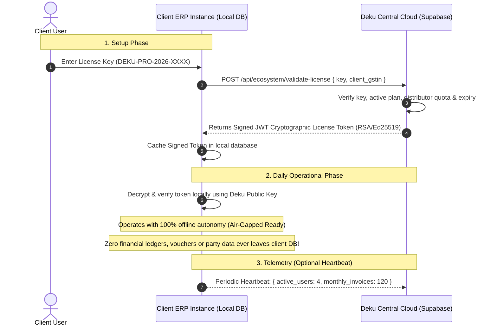

# Deku Finance: Containerisation, 3-Tier Interface Isolation & Database Segregation Blueprint

This document specifies the exact containerisation, frontend workspace decoupling, backend API engine separation, and database migration segregation between **Deku Central Proprietary Cloud (Our License & Distribution Engine)** and the **Client-End ERP Kernel (Client Operational Data)**.

---

## 1. Frontend Workspace Decoupling & Containerisation

Deku Finance isolates its application boundaries into three independent applications managed under a unified monorepo structure. This guarantees that internal administrative tools, distributor commercial controls, and client financial workspaces never share bundle dependencies, sensitive environment variables, or client-side assets.

```
┌────────────────────────────────────────────────────────────────────────┐
│                              FRONTEND                                  │
│                                                                        │
│  ┌──────────────────────┐  ┌──────────────────────┐  ┌───────────────┐ │
│  │   1. DEKU ADMIN      │  │   2. DISTRIBUTOR     │  │   3. CLIENT   │ │
│  │   (@deku/admin)      │  │   (@deku/distributor)│  │   (@deku/     │ │
│  │                      │  │                      │  │    platform)  │ │
│  │  Port 3000    │  │  Port 3001           │  │  Port 3002           │ │
│  │  deku.datalis.in │  │  admin.datalis.in    │  │  partner.datalis.in  │ │
│  └──────────┬───────┘  └──────────┬───────────┘  └──────────┬───────────┘ │
└─────────────┼─────────────────────────┼──────────────────────┼─────────┘
              │                         │                      │
┌─────────────▼─────────────────────────▼──────────────────────┼─────────┐
│              DEKU CENTRAL PROPRIETARY CLOUD                  │         │
│          (Our Supabase / Central Postgres Instance)          │         │
│                                                              │         │
│  • Platform Super-Admin Governance (Medhansh / Master Key)   │         │
│  • Regional Distributor Directory, States & Pincode Quotas   │         │
│  • Dual-Gate License Request Approvals & Commercial Proofs   │         │
│  • Inbound Client Lead Routing & Location Engine             │         │
│  • Module Entitlement Provisioning (Seats, Godowns, AI CFO)  │         │
└──────────────────────────────────────────────────────────────┘         │
                                                                         │
                                ┌────────────────────────────────────────┘
                                │
┌───────────────────────────────▼────────────────────────────────────────┐
│                        CLIENT-END ERP KERNEL                           │
│     (Shared Cloud · Dedicated Private VPC · Air-Gapped On-Premises)    │
│                                                                        │
│  • ALERX 4-Tier Double-Entry General Ledger (ΣDr = ΣCr)                │
│  • Invoicing & Billing Engine (Tax Invoices & Bills of Supply)         │
│  • Procurement, Vendor Bills, Payment Vouchers & Proof Blobs           │
│  • Inventory Ledger, FIFO Stock Movements & Godown Tracking            │
│  • Algorithmic Bank Reconciliation & Marketplace Settlement Hub        │
│  • GST Compliance Engine, 15,000+ HSN Master & GSTR-1/3B Compilers    │
│  • Role-Based Payroll & Confidential Salary Masking                    │
│  • Immutable Append-Only Audit Trail & Gapless Server Sequences        │
└────────────────────────────────────────────────────────────────────────┘
```

---

### The Three Isolated Interfaces

#### Interface 1: DEKU Admin (`@deku/admin`)
- **Target Audience:** Internal platform leadership (Medhansh & master platform engineering team).
- **Domain & Deployment:** `admin.datalis.in` (Container: `deku-admin`, Port `3001`).
- **Isolation Principle:** Built as a standalone Next.js container. No customer has access to this bundle or route.
- **Key Responsibilities:**
  1. **Regional Distributor Governance:** Provision regional franchise partners, assign designated states and pincodes, allocate quota packs (seat packs and service credits).
  2. **Dual-Gate License Activation Desk:** Review formal distributor license requests, inspect mandatory commercial proof documents (Tax Invoice / MoU / PO byte attachments), and generate cryptographic license keys.
  3. **Module Provisioning:** Activate/deactivate commercial add-on modules (`ai_cfo`, `multi_branch`, `inventory_godown`, `direct_gsp_irp`).
  4. **Global Analytics:** High-level network telemetry (total deployed nodes, active licenses, renewal dates).

#### Interface 2: Distributor Partner Portal (`@deku/distributor`)
- **Target Audience:** Certified regional distributors and franchise partners.
- **Domain & Deployment:** `partner.datalis.in` (Container: `deku-distributor`, Port `3002`).
- **Isolation Principle:** Independent bundle with authentication restricted to distributor credentials (`distributor_code` + password).
- **Key Responsibilities:**
  1. **Inbound Client Lead Inbox:** Automatically receives prospective enterprise leads routed by state and pincode.
  2. **Dual-Gate License Request Submission:** Submit client setup requests with client GSTIN, plan tier (GO, PRO, Enterprise), and upload mandatory commercial proof files.
  3. **Quota & Seat Allocation:** Allocate self-service seats and add-on module packs from their pre-purchased quota balance.
  4. **Client Lifecycle & Renewals:** Track client contract validity, upcoming renewal dates, and license status.

#### Interface 3: Deku ERP Platform (`@deku/platform`)
- **Target Audience:** Client Enterprise Users (Business Owners, CFOs, Accountants, Cashiers, Auditors).
- **Domain & Deployment:** `deku.datalis.in` (Container: `deku-platform`, Port `3000`).
- **Isolation Principle:** Client-facing ERP containing the entire accounting desk, GST compliance, banking, and payroll.
- **Authentication & Licensing:**
  - Login requires valid **Company License Key** (`DEKU-XXXX-XXXX-XXXX`), Work Email, and Password.
  - No open self-signup; prospective clients submit an onboarding request that automatically routes to their regional distributor.
  - Contains zero distributor or platform super-admin administrative code.

---

## 2. Backend Engine Architecture: Core, Kernel & Shell

The backend enforces a strict layered separation:

```
┌────────────────────────────────────────────────────────────────────────┐
│                              SHELL                                     │
│  • React 19 / Next.js 16 Web Dashboard · Keyboard-first UX (F4-F9)     │
│  • Dynamic Bharat UPI QR Generator · Client-Side CSV/Excel Parsers     │
│  • E-Invoice User Decision Toggle & ₹50,000+ Threshold Advisor         │
├────────────────────────────────────────────────────────────────────────┤
│                              CORE                                      │
│  • High-Performance Rust / Axum Engine (:8080) & Next.js API Routes   │
│  • JWT Authentication & Session Token Verification                     │
│  • 7-Role RBAC Middleware (Owner, Admin, Accountant, Cashier, etc.)    │
│  • Rule 88A GST Optimal ITC Set-Off Engine · Algorithmic Bank Matcher  │
│  • Marketplace Settlement Transformer (Amazon, Flipkart, Blinkit)      │
│  • Sandbox.co.in IRP & E-Way Bill Connector                            │
├────────────────────────────────────────────────────────────────────────┤
│                             KERNEL                                     │
│  • PostgreSQL 16 Relational Engine                                     │
│  • Strict Double-Entry Parity Invariant Trigger: ΣDr - ΣCr = 0.00      │
│  • Row-Level Security (RLS) Company Isolation (organisation_id UUID)   │
│  • Gapless Server-Generated Voucher Sequences                          │
│  • Permanent Byte-Blob Storage for Proof Documents with SHA-256 Hashes │
│  • Tamper-Proof Cryptographic Audit Events Ledger                      │
└────────────────────────────────────────────────────────────────────────┘
```

---

## 3. Database Migrations Segregation: Proprietary Central vs. Client Kernel

To protect Deku intellectual property, commercial licensing control, and client data privacy, database migrations are partitioned into two distinct categories:

### A. Deku Proprietary Central Migrations (Our Supabase / Private Cloud)
*These tables exist ONLY in our central platform database. They NEVER run on a client's dedicated or on-premises database.*

| Migration File | Tables & Functions Created | Commercial & Proprietary Purpose |
| :--- | :--- | :--- |
| **`000012_organisation_licenses.sql`** | `organisation_licenses`, license keys, seat limits, validity timestamps | Central store of generated master license keys and seat capacities. |
| **`000039_subscriptions.sql`** | `subscription_plans`, billing history, feature matrix entitlement gates | Master definition of GO, PRO, Enterprise commercial feature gates. |
| **`000047_single_customer_runtime.sql`** | `single_customer_runtime` guard function | Guard verifying whether an instance is locked to a single enterprise tenant. |
| **`000059_distributor_and_license_ecosystem.sql`** | `platform_admins`, `distributors`, `distributor_license_requests`, `client_onboarding_requests`, `platform_licenses` | **The Core Commercial Backbone:**<br>• Master directory of platform super-admins (Medhansh).<br>• Regional distributor directory with assigned states & pincodes.<br>• Dual-Gate license requests with commercial proof byte storage.<br>• Inbound client lead routing by state/pincode.<br>• Self-service seat and service credit quota tracking. |

---

### B. Client-End ERP Kernel Migrations (Client Operational Database)
*These tables constitute the client's self-contained financial operations database. They can be deployed on our Shared SaaS Cloud, a Client's Dedicated Private VPC, or an Air-Gapped On-Premises Server.*

| Category | Migration Files Included | What It Operates for the Client |
| :--- | :--- | :--- |
| **Identity & Tenancy** | `000000_platform_auth.sql`<br>`000001_core_identity.sql`<br>`000002_organisations_tenancy.sql`<br>`000016_superadmin_and_7_role_rbac.sql`<br>`000049_login_and_invite_hardening.sql`<br>`000051_password_reset.sql` | Client user accounts, passwords, company profile, 7-role RBAC permissions, and brute-force login security. |
| **Accounting & General Ledger** | `000005_accounting_foundation.sql`<br>`000006_accounting_posting_reporting.sql`<br>`000011_alerx_coa_hierarchy.sql`<br>`000020_journal_approvals.sql`<br>`000021_reports_include_reversed.sql`<br>`000027_allow_journal_reversal.sql`<br>`000029_ledger_functions.sql`<br>`000045_reports_exclude_unposted.sql`<br>`000046_report_functions_use_chart.sql`<br>`000050_voucher_numbers.sql`<br>`000054_report_date_ranges.sql`<br>`000055_edit_draft_journal.sql`<br>*(Upcoming `000060` Periods & Locks)* | Indian GAAP 4-Tier Chart of Accounts (ALERX), double-entry parity invariant ($\sum\text{Dr}=\sum\text{Cr}$), Day Book, Trial Balance, P&L, Balance Sheet, Cash Flow, Maker-Checker approvals, gapless voucher sequences, and period locking. |
| **Sales & Receivables** | `000003_parties.sql`<br>`000004_catalogue_items.sql`<br>`000007_sales_invoices_gst.sql`<br>`000008_invoice_documents.sql`<br>`000010_fix_invoice_issuance_atomic.sql`<br>`000025_sales_invoice_channel.sql`<br>`000030_organisation_profile.sql`<br>`000031_sales_notes.sql`<br>`000032_invoice_types.sql`<br>`000040_invoice_status_guard.sql`<br>`000044_business_documents.sql`<br>*(Upcoming `000063` Sales Orders)* | Customer master, catalogue items, GST Tax Invoices, Bills of Supply, Bharat UPI QR parameters, Credit/Debit Notes, Delivery Challans, and Quotations. |
| **Procurement & Payables** | `000024_purchase_bills.sql`<br>`000048_document_files.sql`<br>*(Upcoming `000064` Procurement & AP)* | Vendor directory, purchase bills, Section 17(5) blocked credit classification, payment vouchers (<kbd>F5</kbd>), and receipt proof byte storage. |
| **Inventory & Warehousing** | `000042_inventory.sql` | Perpetual stock ledger, item tracking, godown allocation, stock adjustments, and FIFO valuation. |
| **Banking & Reconciliation** | `000019_bank_reconciliation.sql`<br>`000035_marketplace_settlements.sql`<br>`000036_payments_razorpay.sql`<br>`000052_bank_name_reconciliation.sql`<br>`000053_neutral_bank_ledger_name.sql`<br>`000056_reconciliation_statements.sql` | Bank account management, CSV statement import, algorithmic match engine, signed monthly reconciliation statements, and marketplace settlements. |
| **GST Compliance & E-Invoicing**| `000028_gst_return_filings.sql`<br>`000033_hsn_sac_master.sql`<br>`000037_gsp_integration.sql`<br>`000038_kyc.sql` | 15,000+ official Indian HSN/SAC tariff codes, GSTR-1 & GSTR-3B compilation tables, Sandbox.co.in IRP integration, IRN hashes, and signed QR codes. |
| **Payroll & Personnel** | `000013_departments_members.sql`<br>`000022_guard_payroll.sql`<br>`000057_employee_pay_privacy.sql`<br>`000058_payroll_posts_to_ledger.sql`<br>*(Upcoming `000065` Statutory Payroll)* | Departmental organization chart, employee master, confidential salary masking (Row-Level Security), and 1-click atomic payroll posting to the ledger. |
| **Audit & Governance** | `000009_audit_events.sql`<br>`000014_user_activity_logs.sql`<br>`000018_lock_down_functions.sql`<br>`000026_lock_down_auth.sql` | Tamper-evident audit events, user activity tracking, and database security lockdown. |
| **Intelligence & Analytics** | `000015_agentic_memory_core.sql`<br>`000017_universal_financial_rollup.sql`<br>`000023_honest_wcm_fpa_metrics.sql`<br>*(Upcoming `000061` Cost Centres & Budgets)*<br>*(Upcoming `000062` Fixed Assets)*<br>*(Upcoming `000066` Project Costing)*<br>*(Upcoming `000067` FP&A Forecasting)* | Deku Consultant deterministic Q&A memory, working capital metrics (DSO, DPO, CCC), and departmental budget rollups. |

---

## 4. Client License Verification Model (How Client Verifies Against Central)

When a client runs their ERP on a dedicated server or on-premises, how does their instance verify licensing without leaking their private accounting data?



### Guarantees of this Model:
1. **Zero Financial Leakage:** Client books, ledgers, vouchers, customer details, and bank statements **never leave the client database**.
2. **Offline Autonomy:** The client kernel verifies its license using public-key cryptography cached locally. Even if internet connectivity drops or on-premises networks are air-gapped, the ERP continues running without interruption.
3. **Proprietary IP Protection:** Distributors and clients cannot generate valid license keys or unlock higher-tier add-ons without our Central Supabase cryptographic authorization.
