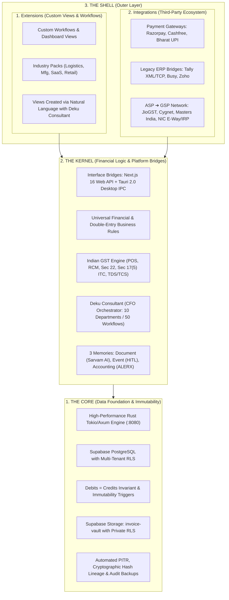
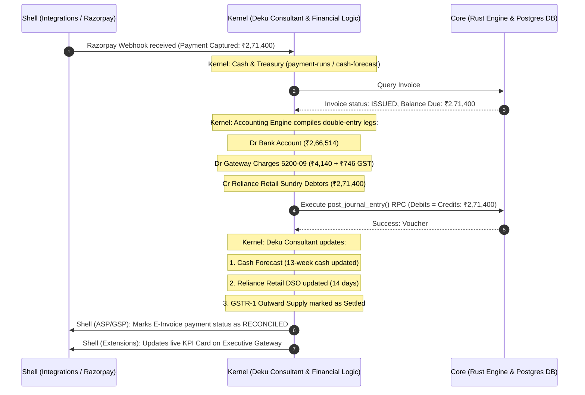

# Deku Finance — Core, Kernel & Shell Architecture
## Complete Specification for Enterprise Financial Operating System & Agentic Deku Consultant

> **Architectural Topology**: 3-Tier Layered Architecture (**Core ➔ Kernel ➔ Shell**).  
> **Interface Portability**: Next.js 16 Web Dashboard + Tauri 2.0 Rust Desktop Runtime.  
> **Agentic Orchestrator**: **Deku Consultant** (CFO Agent coordinating 50+ workflows across 10 financial departments).  
> **Statutory Gateway**: Deku as an **ASP (Application Service Provider)** connected to accredited **GSPs (GST Suvidha Providers)** for automated e-invoicing, e-way bills, and return filing.

---

## 1. Executive Structural Overview

Deku Finance separates platform concerns into three concentric layers. Every transaction, workflow, and automated agent action flows strictly inward toward mathematical and statutory guarantees:



---

## 2. Layer 1: The Core (Data Foundation & Immutability)

The **Core** is the non-negotiable mathematical and transactional foundation. It has zero awareness of UI components or third-party webhooks—it only knows conservation of value, multi-tenant isolation, cryptographic proof, and zero-loss persistence.

### 1. High-Performance Rust Microservice Engine
- Written in Rust using Tokio, Axum, and SQLx.
- Compiles down to bare-metal native binaries with zero garbage collection pauses and sub-millisecond execution times.
- Exposes type-safe internal domain primitives: `Amount(i64)`, `TaxSplit`, `JournalEntryHeader`, `LedgerPostingLeg`.

### 2. Supabase PostgreSQL & Multi-Tenant Isolation
- **Tenant Integrity**: Every tenant-owned table is bounded by `organisation_id uuid NOT NULL`.
- **Composite Key Guarantees**: Enforces `UNIQUE (organisation_id, id)` and composite foreign keys to guarantee mathematical impossibility of cross-tenant data leakage.
- **Row-Level Security (RLS)**: Enforced via `SECURITY DEFINER` functions `is_org_member()` and `has_role()`.

### 3. Immutable Ledger Engine & Triggers
- **Mathematical Invariant**:
  $$\sum \text{Debits} - \sum \text{Credits} = 0.00$$
  Enforced directly by database trigger `trg_verify_journal_entry_lines_parity`.
- **Immutability Barrier**: Posted vouchers (`status = 'posted'`) cannot be modified or deleted. Any modification requires an atomic reversal voucher via `reverse_journal_entry()`.
- **Authoritative Financial Views**: `view_balance_sheet`, `view_profit_and_loss`, `view_trial_balance`, and `view_general_ledger` calculate balances dynamically from posted lines.

### 4. Document Storage Vault & Backup Security
- **Storage Bucket**: `invoice-vault` (Private, RLS-secured).
- **Lineage Cryptography**: Every file generates an immutable SHA-256 hash at ingestion to guarantee idempotency and prevent duplicate bill processing.
- **Backups**: Continuous write-ahead logging (WAL), Point-in-Time Recovery (PITR), and cold-storage offsite replication.

---

## 3. Layer 2: The Kernel (Financial Logic & Platform Bridges)

The **Kernel** is the central brain of Deku Finance. It encodes all financial rules common to all businesses and provides an interface-agnostic bridge for both Web and Desktop runtimes.

```
┌─────────────────────────────────────────────────────────────────────────────┐
│                            THE DEKU KERNEL                                  │
├──────────────────────────────────────┬──────────────────────────────────────┤
│        PLATFORM BRIDGES              │         UNIVERSAL FINANCIAL LOGIC    │
│  • Next.js 16 Web (REST / SSE)       │  • ALERX 4-Tier Chart of Accounts    │
│  • Tauri 2.0 Desktop (Rust IPC)      │  • Indian GST Tax & Exemption Engine │
│  • Offline-First SQLite Sync         │  • Dynamic DSO/DPO Aging Engine      │
├──────────────────────────────────────┴──────────────────────────────────────┤
│         DEKU CONSULTANT: AGENTIC CFO ORCHESTRATOR (50+ WORKFLOWS)           │
│  • 10 Financial Departments (FP&A, Close, Cash, AR, AP, Margin, etc.)       │
│  • 3-Layer Memory: Document (Sarvam AI), Event (HITL), Accounting (ALERX)   │
└─────────────────────────────────────────────────────────────────────────────┘
```

### 1. The Interface-Agnostic Platform Bridge
The Kernel is decoupled from the presentation layer:
- **Web Runtime (Active Production Scope)**:
  - Next.js 16 + React 19 + TypeScript.
  - Communicates with the Rust Kernel via authenticated REST endpoints and Server-Sent Events (SSE) for live streaming thought trajectories.
- **Desktop Runtime (Deferred / Future Tally Partnership Ready)**:
  - Desktop is **out of immediate project scope**.
  - However, because the Rust Kernel encapsulates 100% of the accounting and domain logic, if a strategic **Tally partnership** occurs in the future, a **Tauri 2.0 desktop shell** can be plugged in directly via native IPC without altering any core financial models or database structures.

### 2. Modular Adaptor Architecture & MCP (Model Context Protocol)
To ensure the Core and Kernel remain adaptive and strong on logic, the Shell connects external services through standardized **Integration Adaptors** and **MCP (Model Context Protocol)** servers:
- **Universal Adaptor Contracts**: The Kernel defines abstract traits/interfaces (`PaymentGatewayAdaptor`, `GspTaxFilingAdaptor`).
- **Model Context Protocol (MCP)**: The Deku Consultant connects to external vendor tools via MCP servers. Third-party platforms expose their schema and actions as standard MCP tools (`mcp__razorpay_fetch_payment`, `mcp__gsp_file_gstr3b`), allowing the agent to discover and invoke integrations dynamically while the Kernel enforces double-entry verification.

### 2. Universal Financial & Tax Logics
Rules encoded into the Kernel that apply to every enterprise:
1. **ALERX Indian GAAP Engine**:
   - 4-Tier Hierarchy: `account_group` ➔ `ledger` ➔ `sub_ledger` ➔ `label`.
   - Strictly enforces that transactions post only to leaf labels marked `is_postable = true`.
2. **Indian GST Rules & Dual-Mode Adaptor**:
   - **Pure Accounting Mode (Section 22 Exemption)**: Enforces ₹0 tax generation and converts vouchers to legal *Bills of Supply / Commercial Invoices* for businesses under ₹20L/₹40L.
   - **Enterprise GST Mode**: Evaluates Place of Supply (POS) rules (Supplier State vs Buyer State), splits tax automatically into CGST + SGST (intra-state) or IGST (inter-state), and calculates UTGST / Cess where applicable.
   - **ITC Restrictions**: Enforces Section 17(5) blocked credit rules and Reverse Charge Mechanism (RCM) liabilities.
3. **Statutory Deductions (TDS / TCS)**:
   - Evaluates Section 194C (Contractor payments > ₹30,000), Section 194Q (Goods purchase > ₹50L), and 194J (Professional fees).
4. **Suspense Guard (Account 5999)**:
   - Absorbs sub-rupee ERP rounding discrepancies ($\le ₹1.00$) automatically into Round Off / Suspense.

### 3. The 3-Tier Memory System
- **Document Memory**: Interacts with `invoice-vault` and **Sarvam AI Document Intelligence API (`/doc-ai/v1`)** to transcribe printed, handwritten, and 22 Indian regional languages into Canonical UFO 2.0 objects.
- **Event Memory**: Tracks the agent's step-by-step reasoning trajectory (`Observe ➔ Think ➔ Plan ➔ Act ➔ Verify`) and stages proposals in state `WAITING_FOR_HUMAN_APPROVAL`.
- **Accounting Memory**: The posted, immutable general ledger reflecting instantly across Trial Balance, Balance Sheet, and P&L.

---

## 4. The Deku Consultant: Agentic CFO Orchestrator (10 Departments, 50 Workflows)

Inspired by autonomous multi-agent departmental models, the **Deku Consultant** acts as the virtual CFO coordinating **50 specialized financial workflows across 10 functional departments**:

```
                                  ┌──────────────────────────────┐
                                  │       DEKU CONSULTANT        │
                                  │   (Virtual CFO Orchestrator) │
                                  └──────────────┬───────────────┘
                                                 │ Coordinates
         ┌──────────────┬──────────────┬─────────┴────┬──────────────┬──────────────┐
         ▼              ▼              ▼              ▼              ▼              ▼
    ┌─────────┐    ┌─────────┐    ┌─────────┐    ┌─────────┐    ┌─────────┐    ┌─────────┐
    │  FP&A   │    │ Account │    │ Cash &  │    │Revenue &│    │ Spend & │    │Pricing &│ ... (10 Depts)
    │Fore-    │    │ & Close │    │Treasury │    │ Collect │    │ Payables│    │ Margin  │
    │ casting │    │         │    │         │    │         │    │         │    │         │
    └────┬────┘    └────┬────┘    └────┬────┘    └────┬────┘    └────┬────┘    └────┬────┘
         │              │              │              │              │              │
     5 Agents       5 Agents       5 Agents       5 Agents       5 Agents       5 Agents
```

### Complete Breakdown of the 10 Functional Departments & 50 Workflows:

#### 1. FP&A & Forecasting
1. `budget-builder`: Builds rolling departmental annual and quarterly budgets.
2. `forecast-model`: Projects 12-month forward revenue, direct costs, and EBITDA.
3. `variance-analysis`: Automatically computes Budget vs Actual variance with anomaly explanation.
4. `scenario-planner`: Runs best-case, worst-case, and base-case financial stress tests.
5. `kpi-tracker`: Monitors Gross Margin, Burn Multiple, Quick Ratio, and Rule of 40.

#### 2. Accounting & Close
6. `month-end-close`: Orchestrates automated period checklist across sub-ledgers.
7. `reconciliations`: Auto-reconciles bank feeds, gateway clearing accounts, and inter-company balances.
8. `journal-review`: Flags anomalous manual journal vouchers and unusual debit/credit splits.
9. `accruals`: Computes unbilled revenue and incurred-but-unbilled expense accruals.
10. `close-checklist`: Verifies statutory locking and generates sign-off packs for auditors.

#### 3. Cash & Treasury
11. `cash-forecast`: Models 13-week direct cash flow projections based on AR/AP aging.
12. `working-capital`: Optimizes cash conversion cycle (CCC = DSO + DIO - DPO).
13. `payment-runs`: Aggregates due vendor bills into batched NEFT/RTGS payment proposal runs.
14. `cash-alerts`: Monitors runway and triggers early warning alerts when reserves drop below threshold.
15. `bank-review`: Performs algorithmic sweep analysis across multi-bank operational accounts.

#### 4. Revenue & Collections
16. `invoicing`: Generates GST-compliant B2B/B2C invoices from contracts and orders.
17. `collections`: Prioritizes aging debtors and orchestrates tiered collection workflows.
18. `credit-control`: Evaluates customer creditworthiness and dynamic DSO discount incentives.
19. `billing-audit`: Scans for unbilled deliveries, missing milestone invoices, and pricing leakage.
20. `revenue-metrics`: Calculates MRR, ARR, Net Revenue Retention (NRR), and churn rates.

#### 5. Spend & Payables
21. `spend-analysis`: Categorizes vendor spend across departments and cost centers.
22. `supplier-review`: Benchmarks recurring vendor costs and flags contract renewal price increases.
23. `purchase-approvals`: Validates 3-way matching (PO ➔ Delivery Challan ➔ Vendor Invoice).
24. `payables`: Schedules payment releases to maximize cash buffer without damaging vendor terms.
25. `expense-audit`: Audits employee expense claims and receipts against company travel policy.

#### 6. Pricing & Margin
26. `pricing-model`: Models dynamic discounting based on customer payment history (DSO).
27. `margin-analysis`: Analyzes gross and contribution margin per product SKU / service line.
28. `unit-economics`: Computes Customer Acquisition Cost (CAC), Lifetime Value (LTV), and Payback.
29. `discount-review`: Audits sales team discount allowances and flags unauthorized price concessions.
30. `cost-to-serve`: Calculates landed operational cost per client or distribution channel.

#### 7. People Finance & Payroll
31. `headcount-plan`: Projects hiring ramp and departmental personnel compensation budgets.
32. `payroll-check`: Audits monthly payroll variation (bonuses, overtime, leaves, loss of pay).
33. `comp-benchmark`: Analyzes internal salary bands against market compensation benchmarks.
34. `commission-calc`: Computes quarterly sales commissions and incentive tier accelerators.
35. `people-cost`: Evaluates total loaded personnel cost (CTC + EPF + ESIC + Gratuity + Perquisites).

#### 8. Fundraising & Investors
36. `investor-update`: Generates monthly investor updates with core metrics and commentary.
37. `pitch-financials`: Prepares audit-ready historical financials and forward projection tables.
38. `data-room`: Automatically organizes contracts, cap tables, tax filings, and audited statements.
39. `cap-table`: Models equity dilution, SAFE notes, convertible debentures, and ESOP pools.
40. `diligence-prep`: Scans books for compliance gaps prior to investor or lender due diligence.

#### 9. Tax & Statutory Controls
41. `vat-gst-prep`: Prepares GSTR-1 outward tables and GSTR-3B tax payment computations.
42. `tax-calendar`: Tracks deadlines for advance tax, TDS payments (7th of month), and GST filings.
43. `controls-review`: Reviews segregation of duties and access permissions across modules.
44. `audit-prep`: Prepares lead schedules and trial balance groupings for statutory auditors.
45. `policy-check`: Audits voucher documentation against Indian Accounting Standards (Ind AS).

#### 10. Board & CFO Strategy
46. `board-pack`: Compiles automated monthly/quarterly executive board decks.
47. `management-accounts`: Prepares detailed monthly MIS packs with drill-downs.
48. `cfo-briefing`: Generates a 2-minute daily briefing for the CFO on key risks and liquidity.
49. `investor-report`: Prepares standardized quarterly performance reporting for institutional shareholders.
50. `strategy-model`: Runs M&A, debt refinancing, and geographic expansion financial models.

---

## 5. Layer 3: The Shell (Extensions & Integrations)

The **Shell** is the customizable outer layer where external systems and user-defined workflows connect to the platform.

```
┌─────────────────────────────────────────────────────────────────────────────┐
│                            THE DEKU SHELL                                   │
├──────────────────────────────────────┬──────────────────────────────────────┤
│         1. EXTENSIONS                │         2. INTEGRATIONS              │
│  • Dynamic Custom Views              │  • Payment Gateways (Razorpay/UPI)   │
│  • User-Defined Industry Workflows   │  • Legacy ERP Bridges (Tally/Busy)   │
│  • Created via Deku Consultant       │  • ASP ➔ GSP Network (JioGST, NIC)   │
└──────────────────────────────────────┴──────────────────────────────────────┘
```

---

### Shell Split 1: Extensions (Custom Views & Workflows via Deku Consultant)

Businesses have unique operational requirements that rigid ERPs fail to accommodate. The Shell allows users to **create custom views and workflows using natural language prompts with the Deku Consultant**:

#### How It Works:
1. **User Prompt**:
   > *"Deku Consultant, I run a logistics firm. Create a custom view for Trip Challans that tracks Vehicle Number, Driver Advance, Toll Receipts, and Diesel Expense, and links them to Account 5100-02."*
2. **Consultant Compilation**:
   - The Consultant compiles a dynamic view schema in the Shell:
     - Form fields: `vehicle_no`, `driver_name`, `driver_advance`, `toll_expense`, `diesel_expense`.
     - Ledger linkage: Maps driver advance to Asset `1130` and diesel to Expense `5100-02`.
     - Route registration: Dynamically provisions the view under `/extensions/logistics-trip-challans`.
3. **Execution**:
   - The user gets a fully functional, tailored workflow page with data tables, filters, and 1-click ledger posting that adheres to all Core invariants.

---

### Shell Split 2: Integrations (The 2 Essential Platform Connectors)

Rather than scattering focus across dozens of third-party tools, the Shell scopes down to connect **two essential platforms** via their APIs or MCP servers:

#### 1. Primary Payment Gateway: Razorpay
- **Core Functionality**:
  - Payment Links generated directly from Sales Invoices and Quotes with embedded Bharat UPI QR.
  - Razorpay Checkout & Hosted Payment Pages.
  - **Webhook Engine & Auto-Ledger Reconciliation**:
    - Listens for `payment.captured` and `refund.processed` webhooks.
    - Resolves invoice number and triggers atomic double-entry posting:
      - $Dr$ Bank Clearing Account (`1110`)
      - $Dr$ Payment Gateway Fee Expense (`5200-09`)
      - $Dr$ Input GST on Gateway Fee (`1311/1312`)
      - $Cr$ Customer Accounts Receivable (`1200`)
    - Marks invoice status as `PAID` with zero manual bookkeeping.

#### 2. Primary GST Service Provider (GSP): Authorized Filing Gateway
Deku Finance operates as an **ASP (Application Service Provider)** connected to an authorized **GSP (e.g. JioGST / Cygnet / Masters India)** to fulfill the legal tax and compliance obligations of Indian businesses:

```
┌─────────────────────────┐         ┌─────────────────────────┐         ┌─────────────────────────┐
│       DEKU FINANCE      │  REST   │      GSP GATEWAY        │ Secure  │     GSTN / IRP / NIC    │
│   (Application Service  │ ──────► │ (JioGST / Cygnet /      │ ──────► │ (Government Portal /    │
│        Provider)        │         │      Masters India)     │ Tunnel  │     E-Way Bill System)  │
└─────────────────────────┘         └─────────────────────────┘         └─────────────────────────┘
```

#### Core ASP ➔ GSP Capabilities:
1. **Real-Time GSTIN Verification**:
   - Validates counterparty GSTINs against the live government database, fetching trade name, filing status, and active/inactive flag.
2. **E-Invoicing via IRP (Invoice Registration Portal)**:
   - Formats invoice payloads to the official government JSON schema (INV-01).
   - Transmits to IRP via GSP, receiving an authenticated **IRN (Invoice Reference Number)**, digital signature, and signed QR code.
3. **Automated E-Way Bill Generation**:
   - Generates Part A and Part B E-Way Bills instantly upon invoice creation when goods value exceeds ₹50,000.
4. **Auto GSTR-2B Inward Matching**:
   - Downloads monthly GSTR-2B data directly from the GST portal via GSP.
   - The Deku Consultant runs a reconciliation loop comparing GSTR-2B against the internal Purchase Register, identifying:
     - Missing invoices (vendor has not filed).
     - Tax discrepancies (vendor filed wrong taxable value).
     - ITC eligibility and Section 17(5) blocked credits.
5. **Direct 1-Click Return Filing**:
   - Pre-fills GSTR-1 and GSTR-3B forms directly from Accounting Memory and transmits to the GST portal via GSP OTP authentication.

---

## 6. Synthesis: How a Request Traverses Core, Kernel & Shell

Let us trace the complete lifecycle of a complex business action through the architecture:

> **Example**: *Customer pays an invoice via Razorpay link; Deku Consultant auto-reconciles payment, updates cash forecast, logs audit trail, and prepares GSTR-1.*



---

## 7. Strategic Technical Roadmap

| Phase | Core Objective | Key Deliverables |
|---|---|---|
| **Phase 1: Kernel Foundation & Sarvam AI** | Multi-Memory Foundation | Ingestion from `invoice-vault` via Sarvam AI Doc Intelligence (`/doc-ai/v1`); UFO 2.0 Normalization; Staged Event Memory. |
| **Phase 2: Deku Consultant Workflows** | 10 Financial Departments | Deployment of the 50 specialized agentic workflows across FP&A, Close, AR, AP, Margin, and Tax. |
| **Phase 4: Shell Integrations (The Big 2)** | Razorpay & GSP Gateway | Live Razorpay webhook reconciliation + Authorized GSP pipe for legal GSTR-1/3B filing and GSTR-2B matching. |
| **Phase 5: Shell Extensions Engine** | Natural Language Page Builder | Consultant-driven dynamic view generator allowing businesses to create custom workflow pages. |
| **Deferred: Desktop (Tauri 2.0 / Tally Bridge)** | Partnership Adaptor | Native desktop shell packaging if Tally partnership materializes; zero core rewrite required due to decoupled Kernel. |
