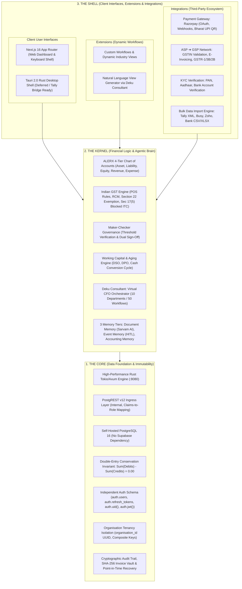
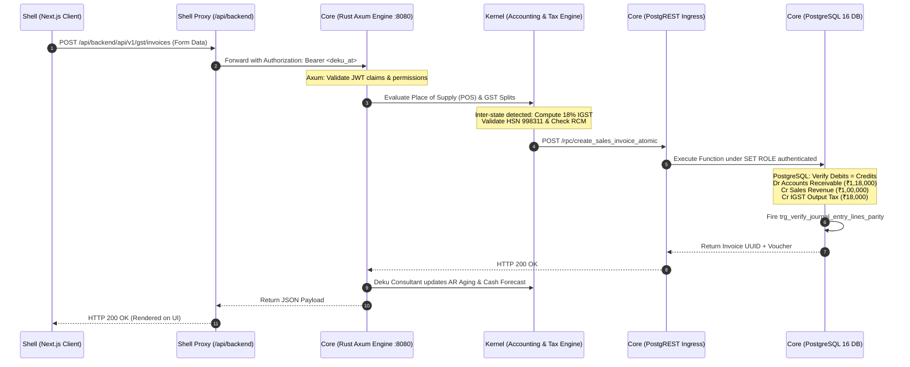

# Deku Finance — Core, Kernel & Shell Architecture
## Complete Architecture Reference for AI Agents & Enterprise Engineering

> **Architectural Topology**: 3-Tier Layered Architecture (**Core ➔ Kernel ➔ Shell**).  
> **Interface Runtimes**: Next.js 16 Web Dashboard (Active) + Tauri 2.0 Rust Desktop Shell (Decoupled & Partnership-Ready).  
> **Agentic Orchestrator**: **Deku Consultant** (Autonomous Virtual CFO coordinating 50 workflows across 10 financial departments).  
> **Data & Storage Foundation**: Self-hosted PostgreSQL 16 with Row-Level Security (RLS) + PostgREST v12 + Private Document Storage Vault.  
> **Statutory Gateway**: Deku as an **Application Service Provider (ASP)** connected to accredited **GST Suvidha Providers (GSPs)** and IRP for real-time compliance.

---

## 1. Executive Mental Model: Core ➔ Kernel ➔ Shell

Deku Finance structures all application concerns into three concentric layers. Every user click, background synchronization, and autonomous agent action flows strictly inward toward mathematical and statutory guarantees:



---

## 2. Layer 1: The Core (Data Foundation & Immutability)

The **Core** is the non-negotiable mathematical and transactional foundation. It has zero awareness of UI components or external vendor webhooks; it enforces conservation of value, multi-tenant isolation, cryptographic lineage, and zero-loss persistence.

### 2.1 High-Performance Rust Axum Engine (`:8080`)
- Built in Rust using Tokio asynchronous runtime, Axum web framework, Tower middleware, and Reqwest HTTP client.
- Compiles down to a native binary (`backend.exe` / Linux ELF) with zero garbage collection pauses and sub-millisecond route latency.
- Exposes type-safe internal domain primitives: `Amount(i64)` (paisa-level integer precision avoiding floating-point drift), `TaxSplit`, `JournalEntryHeader`, `LedgerPostingLeg`.
- Handles password hashing via **bcrypt** (cost 12), token signing via **HS256 JWT** (with 32+ byte cryptographically random secret), and AES-256-GCM symmetric encryption for third-party credentials.

### 2.2 Independent PostgreSQL 16 & Self-Contained Auth Schema
- **Zero Cloud-Vendor Lock-in**: Fully decoupled from Supabase managed services. Migration `000_platform_auth.sql` natively creates the `auth` schema:
  - `auth.users`: Stores user UUIDs, normalized emails, bcrypt password hashes, and metadata.
  - `auth.refresh_tokens`: Stores cryptographically secure 32-byte base64url refresh tokens (indexed by SHA-256 hex) with 30-day lifespans and automatic rotation.
  - `auth.uid()`, `auth.jwt()`, `auth.role()`: Stored procedures that extract authenticated identity context directly from PostgreSQL transaction settings (`request.jwt.claims`).
- **PostgREST v12 Data Access Layer**:
  - Operates as an internal container connecting via `authenticator` role.
  - Verifies JWT signatures, maps claims, and executes SQL queries under `authenticated` or `anon` database roles.
  - Bypasses traditional ORM overhead, transforming HTTP REST queries directly into optimized PostgreSQL SQL and JSON aggregations.

### 2.3 Row-Level Security (RLS) & Multi-Tenant Boundary
- Every tenant-owned table is bounded by `organisation_id uuid NOT NULL`.
- Enforces composite unique constraints `UNIQUE (organisation_id, id)` and composite foreign keys to guarantee mathematical impossibility of cross-tenant data leakage.
- Row-Level Security is enabled on every table in the `public` schema. Policy enforcement is managed via `SECURITY DEFINER` functions:
  - `public.is_org_member(p_org_id uuid)`: Confirms active membership in the requested organisation.
  - `public.has_role(p_org_id uuid, p_roles organisation_role[])`: Confirms the caller holds sufficient RBAC clearance for the requested action.

### 2.4 Immutable Double-Entry Ledger Engine
- **Mathematical Invariant**:
  $$\sum \text{Debits} - \sum \text{Credits} = 0.00$$
  Enforced directly at the database engine level via trigger `trg_verify_journal_entry_lines_parity`. Any transaction violating exact debit-credit parity is aborted by the database.
- **Append-Only Immutability Barrier**:
  - Once a voucher transitions to `posted` (`status = 'posted'`), database triggers prevent any `UPDATE` or `DELETE` on the voucher header or lines.
  - Financial corrections are strictly append-only: an erroneous entry must be reversed via `reverse_journal_entry()`, creating an explicit compensating transaction with full audit linkage.
- **Authoritative Database Views**:
  - `view_trial_balance`: Aggregates debits and credits dynamically across all posted ledger lines.
  - `view_balance_sheet`: Computes Asset, Liability, and Equity net totals.
  - `view_profit_and_loss`: Computes Revenue and Expense net totals.
  - `view_general_ledger`: Exposes chronological transaction history with running balances per sub-ledger.

---

## 3. Layer 2: The Kernel (Financial Logic & Platform Bridges)

The **Kernel** is the central financial intelligence of Deku Finance. It encodes all GAAP and Indian statutory accounting rules, enforces corporate governance, and hosts the **Deku Consultant** autonomous agentic orchestrator.

### 3.1 ALERX 4-Tier Chart of Accounts Hierarchy
Every financial event in Deku Finance maps to the standardized 5-element ALERX structure:
1. **Assets** (Code `1000`): Cash, Bank, Receivables, Inventory, Fixed Assets.
2. **Liabilities** (Code `2000`): Payables, Loans, Statutory Dues (GST/TDS Payable).
3. **Equity** (Code `3000`): Share Capital, Retained Earnings, Partner Draw.
4. **Revenue** (Code `4000`): Operating Sales, Service Income, Other Income.
5. **eXpenses** (Code `5000`): Direct Costs, Salaries, Rent, Payment Gateway Charges, Depreciation.

**Strict Hierarchy**:
$$\text{Account Group} \longrightarrow \text{Ledger} \longrightarrow \text{Sub-Ledger} \longrightarrow \text{Label}$$
Postings are restricted exclusively to leaf-level sub-ledgers where `is_postable = true`.

### 3.2 Indian Statutory GST & Tax Engine
The Kernel features a dual-mode statutory tax engine:
1. **Pure Accounting Mode (Section 22 Exemption)**:
   - For businesses below statutory turnover thresholds (₹20 Lakh for services / ₹40 Lakh for goods).
   - Generates legal **Bills of Supply** / Commercial Invoices with ₹0 tax liability and zero CGST/SGST/IGST breakdown.
2. **Enterprise GST Mode**:
   - Evaluates **Place of Supply (POS)** rules:
     - Intra-State ($\text{Supplier State} = \text{Buyer State}$): Splits tax equally into **CGST + SGST**.
     - Inter-State ($\text{Supplier State} \ne \text{Buyer State}$): Applies unified **IGST**.
     - Union Territories: Applies **UTGST**.
   - **Reverse Charge Mechanism (RCM)**: Automatically identifies unregistered vendor transactions and books output tax liability with matching input tax credit.
   - **Section 17(5) Blocked ITC**: Flags inelligible input tax credits (food & beverages, motor vehicles, employee personal benefits) and capitalizes them directly into expense accounts.
3. **Statutory Deductions (TDS / TCS)**:
   - Automates Section 194C (contractors), Section 194J (professional fees), and Section 194Q (goods purchase > ₹50L).
4. **Suspense Guard (Account 5999)**:
   - Traps sub-rupee rounding discrepancies ($\le ₹1.00$) into a dedicated suspense ledger, guaranteeing ledger balance without rejecting real-world invoices.

### 3.3 Maker-Checker Governance & Internal Controls
- Prevents unilateral transaction execution and fraud.
- Vouchers exceeding configurable organisation thresholds (e.g., > ₹50,000) or drafted by junior bookkeepers enter `pending_approval` status.
- Final posting requires explicit sign-off by a designated `checker` (`cfo`, `admin`, or `owner`).
- Segregation of duties ensures the maker cannot approve their own submission.

### 3.4 Dynamic Working Capital & Aging Engine
- Evaluates real-time Days Sales Outstanding (DSO) for receivables and Days Payable Outstanding (DPO) for vendor bills.
- Computes Cash Conversion Cycle (CCC):
  $$\text{CCC} = \text{DSO} + \text{DIO} - \text{DPO}$$
- Dynamically assigns customer risk scores and triggers early-settlement cash discount incentives.

---

## 4. The Deku Consultant: Autonomous CFO Orchestrator

The **Deku Consultant** is an agentic AI financial copilot designed to operate as an autonomous virtual CFO. It coordinates **50 specialized financial workflows across 10 functional departments**:

```
                              ┌──────────────────────────────┐
                              │       DEKU CONSULTANT        │
                              │   (Virtual CFO Orchestrator) │
                              └──────────────┬───────────────┘
                                             │ Coordinates
     ┌──────────────┬──────────────┬─────────┴────┬──────────────┬──────────────┐
     ▼              ▼              ▼              ▼              ▼              ▼
┌─────────┐    ┌─────────┐    ┌─────────┐    ┌─────────┐    ┌─────────┐    ┌─────────┐
│  FP&A   │    │ Account │    │ Cash &  │    │Revenue &│    │ Spend & │    │Pricing &│ ... (10 Depts)
│Fore-    │    │ & Close │    │Treasury │    │ Collect │    │ Payables│    │ Margin  │
│ casting │    │         │    │         │    │         │    │         │    │         │
└────┬────┘    └────┬────┘    └────┬────┘    └────┬────┘    └────┬────┘    └────┬────┘
     │              │              │              │              │              │
 5 Workflows    5 Workflows    5 Workflows    5 Workflows    5 Workflows    5 Workflows
```

### The 10 Functional Departments & 50 Workflows:

| Department | 5 Specialized Workflows | Core Responsibilities |
|---|---|---|
| **1. FP&A & Forecasting** | `budget-builder`, `forecast-model`, `variance-analysis`, `scenario-planner`, `kpi-tracker` | Rolling budgets, 12-month forward EBITDA projections, budget vs actual variance, financial stress testing, Rule of 40. |
| **2. Accounting & Close** | `month-end-close`, `reconciliations`, `journal-review`, `accruals`, `close-checklist` | Period-end checklists, inter-company reconciliations, anomalous journal review, unbilled accruals, audit sign-off packs. |
| **3. Cash & Treasury** | `cash-forecast`, `working-capital`, `payment-runs`, `cash-alerts`, `bank-review` | 13-week cash flow forecasting, working capital optimization, batched NEFT/RTGS payment proposals, runway alerts. |
| **4. Revenue & Collections** | `invoicing`, `collections`, `credit-control`, `billing-audit`, `revenue-metrics` | GST B2B/B2C invoicing, tiered debtor collection workflows, creditworthiness evaluation, unbilled delivery audits, MRR/ARR. |
| **5. Spend & Payables** | `spend-analysis`, `supplier-review`, `purchase-approvals`, `payables`, `expense-audit` | Departmental spend categorization, vendor price benchmarking, 3-way matching (PO ➔ Challan ➔ Bill), payment release scheduling. |
| **6. Pricing & Margin** | `pricing-model`, `margin-analysis`, `unit-economics`, `discount-review`, `cost-to-serve` | Dynamic DSO-based discounting, SKU gross margin analysis, CAC/LTV computation, discount concession auditing. |
| **7. People & Payroll** | `headcount-plan`, `payroll-check`, `comp-benchmark`, `commission-calc`, `people-cost` | Departmental hiring ramp budgets, monthly payroll variation audits, market salary benchmarking, commission tiers, CTC/EPF. |
| **8. Fundraising & Investors** | `investor-update`, `pitch-financials`, `data-room`, `cap-table`, `diligence-prep` | Monthly investor letters, forward financial models, virtual data room organization, cap-table dilution modeling, diligence checklists. |
| **9. Tax & Statutory** | `vat-gst-prep`, `tax-calendar`, `controls-review`, `audit-prep`, `policy-check` | GSTR-1 & GSTR-3B preparation, advance tax/TDS calendar, segregation of duties auditing, lead schedules for statutory auditors. |
| **10. Board & CFO Strategy** | `board-pack`, `management-accounts`, `cfo-briefing`, `investor-report`, `strategy-model` | Automated executive board decks, monthly MIS reports, 2-minute daily CFO liquidity briefings, M&A/refinancing scenario models. |

### The 3-Tier Agentic Memory System:
1. **Document Memory**: Interacts with the document storage vault and Sarvam AI Document Intelligence (`/doc-ai/v1`) to transcribe printed, handwritten, and multilingual Indian invoices into Canonical UFO 2.0 objects.
2. **Event Memory (HITL)**: Tracks reasoning trajectories (`Observe ➔ Think ➔ Plan ➔ Act ➔ Verify`) and stages sensitive actions in `WAITING_FOR_HUMAN_APPROVAL` before committing ledger writes.
3. **Accounting Memory**: The posted, immutable general ledger reflecting instantly across Trial Balance, Balance Sheet, and P&L.

---

## 5. Layer 3: The Shell (Client Interfaces, Extensions & Integrations)

The **Shell** is the user-facing and external integration perimeter of Deku Finance.

### 5.1 Client Interfaces: Web Dashboard & Desktop Readiness
- **Next.js 16 Web Dashboard (Active Production Scope)**:
  - Built with Next.js 16 App Router, React 19, TypeScript, and Tailwind CSS.
  - Keyboard-first enterprise navigation:
    - Global Function Keys: `F1` (Executive), `F2` (Consultant), `F3` (Vouchers), `F4` (Sales), `F5` (Purchases), `F6` (Collections), `F7` (Document Builder), `F8` (Day Book), `F9` (Approvals), `F10` (Bank Reconciliation), `F11` (GST Returns).
    - `Escape`: Return to Gateway or close open drawers/modals.
    - `Ctrl+K` / `Cmd+K`: Global Omnibox & Command Palette.
    - Transaction-Entry Protection: Suppresses navigation shortcuts when typing inside form inputs, textareas, comboboxes, or code editors.
  - Same-Origin Proxying: Browser code communicates strictly with `/api/backend/*`, which forwards requests to Rust Axum with `Authorization: Bearer <deku_at>`. Tokens are kept in HTTP-only, SameSite cookies and never exposed to client-side JavaScript.
- **Tauri 2.0 Rust Desktop Shell (Deferred / Tally Partnership Ready)**:
  - Because all accounting, tax, and domain logic is encapsulated inside the Rust Kernel and PostgreSQL Core, a native desktop shell can be packaged via Tauri 2.0 with native IPC without altering core business models.

### 5.2 Shell Extensions: Natural Language Custom View Generator
- Enables non-technical business operators to prompt the Deku Consultant to create custom industry workflows (e.g. logistics trip challans, construction work orders, manufacturing job cards).
- The Consultant compiles dynamic form schemas, maps input fields to sub-ledgers, and registers custom route endpoints under `/extensions/*` while respecting all Core immutability triggers.

### 5.3 Shell Integrations: The Essential Platform Connectors
1. **Payment Gateway: Razorpay**:
   - OAuth 2.0 connection per company with AES-GCM encrypted token storage.
   - Generates instant payment links and dynamic Bharat UPI QR codes on invoices.
   - Automated webhook processing (`POST /api/v1/webhooks/razorpay`) with HMAC signature verification:
     - On `payment.captured`: Automatically posts $Dr$ Bank Clearing (`1110`), $Dr$ Gateway Fee (`5200-09`), $Dr$ Input GST on Fee, $Cr$ Customer Accounts Receivable (`1200`), marking the invoice `PAID`.
2. **ASP ➔ GSP Network Gateway**:
   - Deku acts as an Application Service Provider (ASP) communicating with accredited GSPs (JioGST, Cygnet, Masters India) and the government IRP.
   - Real-time GSTIN validation and counterparty status verification.
   - Real-time E-Invoicing (IRP INV-01) generating official IRN hashes and signed QR codes.
   - E-Way Bill generation for consignments exceeding ₹50,000.
   - Automated GSTR-2B inward reconciliation matching government data against internal purchase registers to flag missing vendor filings or blocked ITC.
   - Direct 1-click filing of GSTR-1 outward returns and GSTR-3B summary returns.

---

## 6. End-to-End Transaction Trace

The following diagram illustrates how an operational transaction traverses the Shell, Kernel, and Core layers:



---

## 7. Architecture Summary for AI Assistants

When developing or extending Deku Finance, adhere to these fundamental principles:
1. **The Core is Sovereign**: Never bypass double-entry debit-credit parity ($\sum Dr - \sum Cr = 0$). Never perform destructive edits on posted vouchers. All corrections are compensating reversal vouchers.
2. **PostgREST Handles Data Access**: Business mutations run through PostgREST RPCs or Axum business routes. Do not invent an uncoordinated SQL layer.
3. **No Supabase Dependency**: The application runtime is self-contained with its own PostgreSQL auth schema (`000_platform_auth.sql`), standard PostgREST v12, and Rust backend.
4. **Security by Default**: All browser API requests must flow through the Next.js same-origin `/api/backend/*` proxy with HTTP-only session cookies. RLS policies with `is_org_member()` and `has_role()` enforce tenant boundaries at the database level.
5. **Indian GAAP & GST Compliance**: Always observe Place of Supply rules, Section 22 turnover exemptions (Bills of Supply), Section 17(5) blocked credits, and maker-checker dual-authorization workflows.
