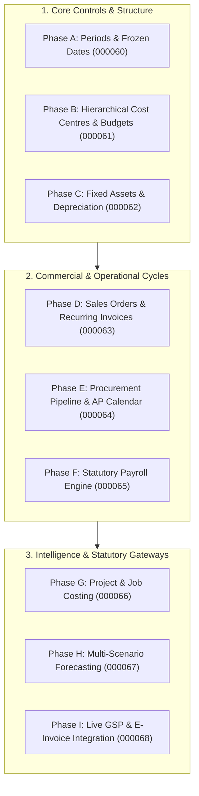

# Deku Finance: Full Financial Suite Implementation Plan
## Comprehensive Technical & Functional Blueprint (18-Module ERP Completion)

**Objective:** Complete all roadmap, partial, and pending financial features across Deku Finance to deliver a comprehensive, enterprise-grade ERP on par with Tier-1 financial platforms.

---

## 1. Executive Implementation Roadmap Overview

| Phase | Functional Focus Areas | Key Deliverables | DB Migrations |
| :---: | :--- | :--- | :---: |
| **Phase A** | **Governance, Controls & Period Closing** | Accounting period locks, frozen dates trigger, year-end closing procedure | `000060` |
| **Phase B** | **Departmental Cost Centres & Budget Enforcement** | Hierarchical cost-tree departments, hard budget spending blocks & warnings | `000061` |
| **Phase C** | **Fixed Asset Register & Automated Depreciation** | Asset master, SLM/WDV schedule generator, auto-posting depreciation journals | `000062` |
| **Phase D** | **Commercial Sales Pipeline & Billing Automation** | Sales orders, delivery challans, recurring invoice scheduler, early-payment discounts | `000063` |
| **Phase E** | **Procurement Pipeline & Supplier Scheduling** | Material requests, RFQs, PO approvals, AP payment calendar with MSME 45-day timer | `000064` |
| **Phase F** | **Statutory Payroll Engine & Payslips** | Indian statutory deduction engine (PF, ESIC, PT, Sec 192 TDS), PDF payslips | `000065` |
| **Phase G** | **Project & Job Costing Finance** | Project budgets, timesheet costing, project profitability & cash flow | `000066` |
| **Phase H** | **FP&A Multi-Scenario Forecasting** | 12-month rolling projections (Best, Base, Worst Case), sensitivity models | `000067` |
| **Phase I** | **Direct GSP / E-Invoicing & E-Way Bill Integration** | GSP connectors (ClearTax / Masters India / Sandbox), IRN generation & E-Way bills | `000068` |

---

## 2. GSP Connector Analysis & Tentative Pricing

To enable direct 1-click filing of GSTR-1, GSTR-3B, automated GSTR-2B download, and live government E-Invoicing (IRN) / E-Way Bills, Deku Finance connects to certified **GST Suvidha Providers (GSPs)** and **Application Service Providers (ASPs)**.

### Top GSP Connectors in India

| Provider | Service Scope & Strengths | Integration Architecture | Tentative Commercial Pricing | Recommendation |
| :--- | :--- | :--- | :--- | :---: |
| **Masters India (autoGST API)** | • Direct certified GSP with NIC IRP & GSTN tunnels. • E-Invoicing (IRN + Signed QR), E-Way Bill, GSTR-1/3B filing, GSTR-2B sync. • High-availability REST APIs with SDKs. | Standard REST API / JSON with API Key & Secret; webhook events for IRN status. | **Base Tier:** ~₹15,000 – ₹30,000 / year. **Volume Pack:** ~₹1.20 – ₹2.50 per generated IRN / E-Way Bill. | **Recommended for Mid-Market & SME ERP** (Cost-effective, straightforward developer docs). |
| **Clear (formerly ClearTax Enterprise API)** | • Market leader in enterprise tax compliance. • Direct IRP multi-session failover, automated 2B reconciliation engine, advance tax credit optimization. • Proven high enterprise volume stability. | OAuth2 / API Gateway with encrypted headers; comprehensive sandbox environments. | **Enterprise Base:** ~₹35,000 – ₹60,000 / year. **Volume Pack:** ~₹2.00 – ₹4.50 per invoice document. | **Recommended for Large Enterprise & High-Volume Clients**. |
| **Sandbox.co.in (Fintech / Developer API)** | • Modern developer-first unified API hub. • Fast onboarding, self-serve developer portal. • GSTIN verification, PAN-Aadhaar linkage, IRN generator, E-Way bill APIs. | Modern OpenAPI REST / JSON with JWT auth; instantaneous sandbox testing. | **Pay-as-you-go:** ~₹1.50 – ₹2.00 per API call with pre-funded wallet credits (e.g., ₹5,000 starter pack). | **Recommended for Fast Prototype & Developer Testing**. |
| **IRIS GST (IRIS Onyx & Topaz)** | • Authorized GSP since 2017. • Highly trusted by listed Indian corporations and banks. • Comprehensive ASP/GSP dual pipeline. | Enterprise SOAP / REST endpoints with dedicated VPN or leased lines. | **Annual Contract:** ~₹30,000 – ₹50,000 / year base. | **Recommended for Regulated & High-Security Accounts**. |

### Recommended Integration Strategy for Deku Finance:
1. **Dual Connector Architecture:** Provide a pluggable adapter pattern:
   - `Sandbox.co.in` or `Masters India` as default fast-activation provider for GO and PRO tiers.
   - `Clear Enterprise` or client's own direct GSP credentials for Enterprise dedicated deployments.
2. **Offline Fallback Guarantee:** When GSP credentials are not yet configured or during government portal maintenance, Deku continues to offer 1-click **Official Offline Portal JSON** export (already live today).

---

## 3. Detailed Phase-by-Phase Technical Specification

---

### Phase A: Accounting Periods, Period Closing & Frozen Dates
*Guaranteeing regulatory compliance and preventing backdated voucher entry once books are closed.*

#### 1. DB Migrations (`20261114000060_accounting_periods_and_frozen_dates.sql`)
- **Tables & Columns:**
  - `accounting_periods`: `id`, `organisation_id`, `name` (e.g. "FY 2025-26 Q1", "March 2026"), `period_type` (`monthly`, `quarterly`, `annual`), `start_date`, `end_date`, `is_closed` (BOOLEAN), `closed_by`, `closed_at`.
  - `organisations.frozen_accounting_date`: `DATE` column in `organisations` table.
- **Triggers & Stored Procedures:**
  - `check_frozen_accounting_date()`: Trigger on `journal_entries` before INSERT, UPDATE, or DELETE. Raises an exception: `"Cannot post or modify entries on or before the frozen accounting date (%)"`.
  - `close_fiscal_year(org_id UUID, fiscal_year_end DATE, closing_user_id UUID)`: Atomic procedure that computes net profit/loss for the year, creates a closing journal transferring Revenue and Expense balances into "Reserves & Surplus / Retained Earnings", and advances the frozen accounting date.

#### 2. Backend Engine & APIs
- `GET /api/v1/organisations/:id/periods`: Lists accounting periods and current lock status.
- `POST /api/v1/organisations/:id/periods/create`: Creates fiscal periods.
- `POST /api/v1/organisations/:id/periods/:periodId/close`: Closes a period and sets `is_closed = true`.
- `PATCH /api/v1/organisations/:id/frozen-date`: Updates the company's frozen accounting date (Restricted to `owner` and `admin` roles).
- `POST /api/v1/organisations/:id/fiscal-year/close`: Executes year-end close procedure.

#### 3. Frontend UI (Shell)
- **Settings / Governance View:** Add **"Accounting Locks & Periods"** card in `/settings` and `/reports`.
  - Date picker to set/update "Frozen Accounting Date" with confirmation modal.
  - Interactive table of Monthly / Quarterly periods with "Lock Period" toggles.
  - "Year-End Closing Wizard" with preview of P&L transfer into Balance Sheet Equity.

---

### Phase B: Departmental Cost Centres & Hard Budget Spending Blocks
*Transforming departments into hierarchical cost trees with real-time budget enforcement.*

#### 1. DB Migrations (`20261114000061_hierarchical_cost_centres_and_budget_blocks.sql`)
- **Schema Updates:**
  - In `departments`: Add `parent_department_id UUID REFERENCES departments(id)`, `department_type VARCHAR(32) DEFAULT 'department'` (`department`, `cost_centre`, `division`, `project`), `budget_enforcement_mode VARCHAR(20) DEFAULT 'warning'` (`none`, `warning`, `strict_block`).
  - `department_budgets`: `id`, `department_id`, `fiscal_year`, `period` (`annual`, `q1`, `q2`, `q3`, `q4`, `monthly`), `budget_limit NUMERIC(15,2)`, `warning_threshold_pct NUMERIC(5,2) DEFAULT 80.0`.
- **Triggers & Validation:**
  - `validate_department_budget_on_posting()`: Stored function called before committing expense vouchers or purchase bills. If `budget_enforcement_mode == 'strict_block'` and current period posted spend + new entry > `budget_limit`, aborts transaction with error: `"Budget Exceeded: Department [%] has exceeded its allocated limit of ₹%"`.

#### 2. Backend Engine & APIs
- `GET /api/v1/organisations/:id/departments/tree`: Returns recursive tree of parent departments and nested cost centres.
- `POST /api/v1/organisations/:id/departments/:id/budget`: Sets budget limits and enforcement mode (`warning` vs `strict_block`).
- `GET /api/v1/organisations/:id/departments/budget-status`: Real-time budget consumption API calculating actual spent vs budget with warning flags.

#### 3. Frontend UI (Shell)
- **Departments & Cost Centres View (`/departments-members`):**
  - Cost Centre Hierarchy view showing nested sub-departments and divisions.
  - Budget configuration modal with slider for Warning Threshold (e.g., 80%) and toggle for "Strict Spending Block" (preventing voucher posting).
  - Highlighting over-budget departments in amber (warning) or red (blocked).

---

### Phase C: Fixed Asset Register & Automated Depreciation Engine
*Asset tracking with Indian Companies Act 2013 and Income Tax Act compliant depreciation.*

#### 1. DB Migrations (`20261114000062_fixed_assets_and_depreciation.sql`)
- **Tables:**
  - `fixed_assets`: `id`, `organisation_id`, `asset_code`, `asset_name`, `category` (`plant_machinery`, `computers`, `furniture_fixtures`, `vehicles`, `buildings`, `land`), `purchase_date`, `put_to_use_date`, `purchase_cost NUMERIC(15,2)`, `salvage_value NUMERIC(15,2)`, `depreciation_method` (`slm`, `wdv`), `useful_life_years NUMERIC(5,2)`, `depreciation_rate_pct NUMERIC(5,2)`, `accumulated_depreciation NUMERIC(15,2) DEFAULT 0`, `current_book_value NUMERIC(15,2)`, `fixed_asset_ledger_id UUID`, `accumulated_depreciation_ledger_id UUID`, `depreciation_expense_ledger_id UUID`, `status` (`active`, `disposed`, `scrapped`).
  - `asset_depreciation_schedules`: `id`, `asset_id`, `schedule_date`, `depreciation_amount NUMERIC(15,2)`, `opening_book_value NUMERIC(15,2)`, `closing_book_value NUMERIC(15,2)`, `is_posted BOOLEAN DEFAULT false`, `journal_entry_id UUID`.
- **Stored Procedures:**
  - `generate_asset_depreciation_schedule(asset_id UUID)`: Generates period-wise depreciation table based on SLM or WDV formula.
  - `post_depreciation_run(org_id UUID, run_date DATE)`: Automatically creates balancing journal entries: `Dr Depreciation Expense / Cr Accumulated Depreciation` for all unposted schedules up to `run_date`.

#### 2. Backend Engine & APIs
- `GET/POST /api/v1/organisations/:id/assets`: Lists and registers new capital assets.
- `GET /api/v1/organisations/:id/assets/:id/schedule`: Returns calculated depreciation schedule.
- `POST /api/v1/organisations/:id/assets/depreciation/post-batch`: Posts depreciation for the selected month to the general ledger.
- `POST /api/v1/organisations/:id/assets/:id/dispose`: Handles asset sale or scrap with automated Gain/Loss on Disposal calculation.

#### 3. Frontend UI (Shell)
- **Fixed Asset Register (`/masters/assets` or `/assets`):**
  - Asset summary grid with acquisition cost, written down value (WDV), and accumulated depreciation.
  - "Register Capital Asset" modal with purchase bill selector and SLM/WDV method picker.
  - "Run Monthly Depreciation" one-click button with preview of journal debits and credits.
  - Asset schedule drawer showing remaining useful life and annual amortization.

---

### Phase D: Commercial Sales Pipeline & Billing Automation
*Sales Orders, recurring invoice schedules, and early-payment cash discounts.*

#### 1. DB Migrations (`20261114000063_sales_orders_and_recurring_billing.sql`)
- **Tables & Updates:**
  - `sales_orders`: `id`, `organisation_id`, `order_number`, `party_id`, `order_date`, `delivery_due_date`, `status` (`draft`, `confirmed`, `partially_invoiced`, `completed`, `cancelled`), `subtotal`, `tax_total`, `grand_total`, `notes`.
  - `sales_order_items`: line items with ordered quantity, invoiced quantity, rate, tax.
  - `recurring_invoice_profiles`: `id`, `organisation_id`, `party_id`, `profile_name`, `frequency` (`weekly`, `monthly`, `quarterly`, `yearly`), `start_date`, `next_run_date`, `end_date`, `template_invoice_data JSONB`, `auto_send_email BOOLEAN`, `status` (`active`, `paused`, `cancelled`).
  - Add to `sales_invoices`: `early_payment_discount_pct NUMERIC(5,2)`, `early_payment_discount_days INT` (e.g. 2% discount if paid within 10 days).
- **Procedures:**
  - `generate_recurring_invoices_batch()`: Cron/API procedure checking `next_run_date <= CURRENT_DATE` and generating draft or issued tax invoices.

#### 2. Backend Engine & APIs
- `GET/POST /api/v1/organisations/:id/sales-orders`: Sales order lifecycle management.
- `POST /api/v1/organisations/:id/sales-orders/:id/convert-to-invoice`: 1-click conversion of confirmed sales order into a tax invoice.
- `GET/POST /api/v1/organisations/:id/recurring-invoices`: Create and monitor recurring profiles.
- `POST /api/v1/organisations/:id/recurring-invoices/run-due`: Manual or cron trigger to generate due recurring invoices.
- `POST /api/v1/organisations/:id/invoices/:id/apply-cash-discount`: Auto-calculates cash discount if payment receipt is posted within the incentive window.

#### 3. Frontend UI (Shell)
- **Sales Orders View (`/sales-orders` or integrated in `/builder`):**
  - Document builder mode toggle: Quotation $\rightarrow$ **Sales Order** $\rightarrow$ Tax Invoice.
  - Fulfillment status badge (e.g., "50% Invoiced").
- **Recurring Invoices Tab:**
  - Dashboard of active recurring subscriptions with upcoming execution dates.
- **Cash Discount Banner:**
  - On invoice preview & receipt voucher: "Early payment eligible: ₹X discount if paid before [Date]".

---

### Phase E: Procurement Pipeline & AP Payment Calendar
*Material Requisitions, Purchase Orders, and visual AP cash outflow scheduling with MSME compliance.*

#### 1. DB Migrations (`20261114000064_procurement_pipeline_and_ap_scheduling.sql`)
- **Tables & Updates:**
  - `material_requests`: `id`, `organisation_id`, `request_number`, `requested_by_user_id`, `department_id`, `purpose`, `status` (`draft`, `submitted`, `approved`, `po_created`, `rejected`), `urgency` (`normal`, `high`, `critical`).
  - `purchase_orders`: `id`, `organisation_id`, `po_number`, `vendor_id`, `po_date`, `delivery_date`, `status` (`draft`, `pending_approval`, `approved`, `partially_billed`, `completed`, `cancelled`), `subtotal`, `tax_total`, `grand_total`.
  - In `purchase_bills`: Add `scheduled_payment_date DATE`, `msme_payment_due_date DATE` (automatically computed as bill date + 45 days if vendor is MSME registered under Section 43B(h)).

#### 2. Backend Engine & APIs
- `GET/POST /api/v1/organisations/:id/material-requests`: Requisition workflow.
- `GET/POST /api/v1/organisations/:id/purchase-orders`: PO creation and approval.
- `POST /api/v1/organisations/:id/purchase-orders/:id/convert-to-bill`: 1-click conversion of approved PO into inward Purchase Bill with quantity variance check.
- `GET /api/v1/organisations/:id/purchases/payment-calendar`: Timeline of upcoming vendor payables grouped by due date, highlighting MSME 45-day overdue risks.

#### 3. Frontend UI (Shell)
- **Procurement Requisitions & POs (`/purchases` sub-tabs):**
  - Material Requisition form with department tagging.
  - Purchase Order creator with vendor selector and tax breakdown.
- **AP Payment Calendar View (`/purchases/calendar`):**
  - Visual monthly/weekly calendar showing daily scheduled payables.
  - Critical amber/red badges for Section 43B(h) MSME accounts approaching the 45-day threshold.
  - 1-click "Create Payment Voucher" directly from any scheduled calendar item.

---

### Phase F: Automated Statutory Payroll Engine & PDF Payslips
*Automating Indian statutory deductions (PF, ESIC, PT, TDS) and employee PDF payslip distribution.*

#### 1. DB Migrations (`20261114000065_statutory_payroll_engine.sql`)
- **Schema Enhancements:**
  - In `department_members` (employee directory): Add `pan`, `aadhaar`, `uan_epf`, `esic_number`, `tax_regime` (`new`, `old`), `basic_pay NUMERIC(12,2)`, `hra NUMERIC(12,2)`, `special_allowances NUMERIC(12,2)`, `state_for_pt VARCHAR(32) DEFAULT 'Maharashtra'`, `epf_applicable BOOLEAN DEFAULT true`, `esic_applicable BOOLEAN DEFAULT false`.
  - `payroll_run_items`: `id`, `payroll_run_id`, `employee_id`, `basic_pay`, `hra`, `allowances`, `gross_salary`, `epf_employee`, `epf_employer`, `esic_employee`, `esic_employer`, `professional_tax`, `tds_section_192`, `total_deductions`, `net_payable`.
- **Functions:**
  - `compute_statutory_payroll(gross_pay NUMERIC, basic_pay NUMERIC, state_code TEXT, ...)`: Computes exact statutory deductions following statutory ceilings.

#### 2. Backend Engine & APIs
- `POST /api/v1/organisations/:id/departments/payroll/calculate`: Accepts employee list and returns auto-computed EPF (12%), ESIC (0.75%), State PT, and TDS.
- `POST /api/v1/organisations/:id/departments/payroll/post`: Generates compound balanced journal vouchers to the general ledger (Expense ledgers Dr vs EPF/ESIC/PT/TDS Payables and Net Salaries Cr).
- `GET /api/v1/organisations/:id/departments/payroll/:runId/payslips/:employeeId/pdf`: Generates high-DPI official Indian PDF payslip with company logo, earnings, deductions, and net pay in words.

#### 3. Frontend UI (Shell)
- **Enhanced Payroll Run Modal (`PayrollRunModal.tsx` in `/departments-members`):**
  - Auto-calculate toggle showing transparent breakdown of Statutory Deductions.
  - Employee Pay Slip Viewer with 1-click PDF download for individual employees.
  - Form 16 / Tax deduction annual summary table for HR/CFO review.

---

### Phase G: Project & Job Costing Finance
*Project-level budget tracking, income, expense allocation, and profitability.*

#### 1. DB Migrations (`20261114000066_project_and_job_costing.sql`)
- **Tables:**
  - `projects`: `id`, `organisation_id`, `project_code`, `project_name`, `party_id` (client), `department_id`, `start_date`, `end_date`, `budgeted_cost NUMERIC(15,2)`, `budgeted_revenue NUMERIC(15,2)`, `status` (`planning`, `in_progress`, `completed`, `on_hold`).
  - In `journal_lines`, `sales_invoice_items`, `purchase_bill_items`: Add `project_id UUID REFERENCES projects(id)` optional dimension column.
- **Reporting Functions:**
  - `get_project_profitability(project_id UUID)`: Computes total project revenue, direct material costs, labor/timesheet expenses, and net project margin.

#### 2. Backend Engine & APIs
- `GET/POST /api/v1/organisations/:id/projects`: Project management CRUD.
- `GET /api/v1/organisations/:id/projects/:id/financials`: Project P&L, budget consumption, and cash flow.

#### 3. Frontend UI (Shell)
- **Project Finance Desk (`/projects`):**
  - Project directory with status, client name, and margin gauges.
  - Project financial summary: Budgeted vs. Actual Spend, Invoiced Revenue vs. Collected Cash.
  - Project tag selector in Voucher Workspace (<kbd>F4</kbd>–<kbd>F9</kbd>) and Document Builder.

---

### Phase H: FP&A Multi-Scenario Financial Forecasting
*12-month rolling cash flow and P&L projections across Best, Base, and Worst Case scenarios.*

#### 1. DB Migrations (`20261114000067_fpa_scenario_forecasting.sql`)
- **Tables:**
  - `fpa_forecast_scenarios`: `id`, `organisation_id`, `name` (`Base Case`, `Optimistic (Best)`, `Stress Test (Worst)`), `revenue_growth_pct NUMERIC(5,2)`, `expense_inflation_pct NUMERIC(5,2)`, `collection_delay_days INT`, `notes`, `created_at`.
  - `fpa_forecast_projections`: 12-month projection rows with projected revenue, OPEX, net burn, and ending liquidity balance.

#### 2. Backend Engine & APIs
- `GET /api/v1/organisations/:id/consultant/forecast`: Runs dynamic 12-month projection engine using historical 6-month trailing ledger trends combined with scenario parameters.
- `POST /api/v1/organisations/:id/consultant/forecast/custom`: Allows CFO to test custom levers (e.g., "+15% Sales, +10 days DSO delay").

#### 3. Frontend UI (Shell)
- **FP&A Multi-Scenario Dashboard (`/executive` or `/consultant` sub-tab):**
  - Interactive 12-Month Liquidity Chart comparing Best Case (green), Base Case (blue), and Worst Case (amber).
  - Sensitivity Levers: Sliders for Revenue Growth %, Overhead Inflation %, and Debtor Collection Delay.
  - Cash Runway runway alert: "Under Worst-Case scenario, cash runway is X months".

---

### Phase I: Live GSP Integration (E-Invoice, E-Way Bill & Portal Sync)
*Direct government gateway connectivity via Masters India / ClearTax / Sandbox APIs.*

#### 1. DB Migrations (`20261114000068_gsp_live_connector.sql`)
- **Tables & Updates:**
  - In `gsp_credentials`: Add `provider` (`masters_india`, `cleartax`, `sandbox_co_in`, `iris`), `auth_token_encrypted`, `token_expiry TIMESTAMPTZ`, `environment` (`sandbox`, `production`).
  - In `sales_invoices`: Add `irn_hash VARCHAR(64)`, `ack_no VARCHAR(32)`, `ack_date TIMESTAMPTZ`, `signed_qr_code TEXT`, `signed_invoice_data TEXT`, `eway_bill_no VARCHAR(32)`, `eway_bill_valid_until TIMESTAMPTZ`, `einvoice_status` (`not_applicable`, `pending`, `generated`, `cancelled`, `failed`), `einvoice_error_message TEXT`.

#### 2. Backend Engine & APIs
- `POST /api/v1/integrations/gsp/einvoice/generate/:invoiceId`: Constructs official standard INV-01 payload, dispatches to GSP API, validates response, stores IRN hash and signed QR code, updates invoice status.
- `POST /api/v1/integrations/gsp/ewaybill/generate/:invoiceId`: Generates E-Way Bill for consignments > ₹50,000 with transporter ID, vehicle number, and distance.
- `POST /api/v1/integrations/gsp/returns/gstr1/direct-file`: Authenticates GSTN session via OTP and pushes GSTR-1 payload directly.

#### 3. Frontend UI (Shell)
- **Invoice Editor & Viewer (`/builder`, `/invoices`):**
  - "Generate IRN / E-Invoice" button for B2B invoices exceeding threshold.
  - High-DPI Invoice PDF displays the government-mandated **Signed QR Code** and **64-digit IRN** in the header.
  - "Generate E-Way Bill" modal prompting for Transporter ID and Vehicle Number.
  - Settings page card: "GSP Government Connector" to configure provider credentials with test connection status indicator.

---

## 4. Execution Sequence & Verification Matrix

### Verification & Test Strategy
For each milestone:
1. **Migration Verification:** Test SQL migrations in Supabase test container with reversible rollbacks.
2. **Double-Entry Parity Invariant:** Verify $\sum \text{Dr} \equiv \sum \text{Cr}$ across all automated depreciation, payroll, recurring billing, and closing procedures.
3. **Automated Vitest Regression:** Expand the existing 46 test suites / 417 passing tests to cover new calculation engines (SLM/WDV depreciation math, statutory PF/ESIC formulas, and budget spending blocks).
4. **TypeScript Strict Type Check:** Enforce 0 type errors across `@deku/platform`, `@deku/admin`, and `@deku/distributor`.
