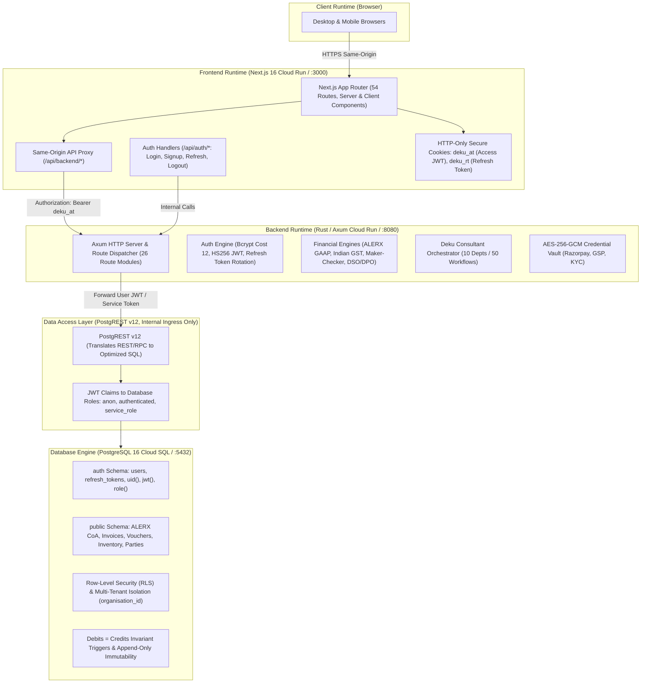
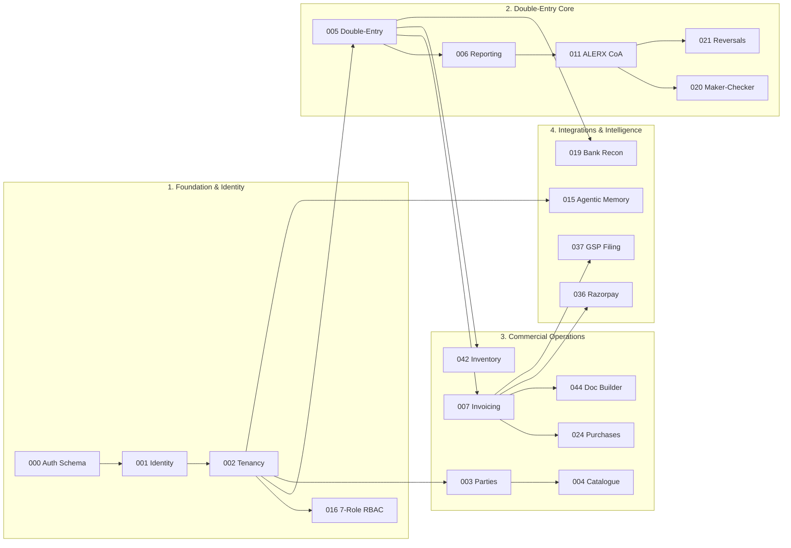

# Deku Finance — Platform & Client Runtime Architecture
## Self-Hosted, Containerised Multi-Tier Financial Architecture

> **Document Status**: Production Specification  
> **Deployment Scope**: Single-Organisation Self-Hosted (Local Docker Compose & Google Cloud Platform)  
> **Key Architecture Decisions**: Fully decoupled from Supabase managed services; PostgreSQL 16 on Cloud SQL or local container; Rust/Axum application backend; PostgREST v12 internal data access layer; Next.js 16 App Router frontend with same-origin secure proxy.

---

## 1. High-Level Runtime Architecture

Deku Finance operates as a 4-tier containerised stack. Browser clients communicate exclusively with the Next.js frontend over HTTPS; Next.js proxies all API requests server-side to the Rust/Axum backend; the backend executes business logic, tax math, and statutory rules before interacting with PostgREST and PostgreSQL.



---

## 2. Client-Side Application Runtime Architecture

### 2.1 Next.js 16 App Router Topology
The client-side application is built on Next.js 16 using the App Router, React 19, TypeScript, and Tailwind CSS.
- **54 Application Routes**: Spanning the Executive Gateway, Universal Voucher Desk, Sales Invoicing, Purchases & ITC, Document Builder, Day Book, Approvals, Banking Reconciliation, GST Filing, Financial Statements (P&L, Balance Sheet, Cash Flow), Inventory, Settings, and Deku Consultant AI.
- **Server vs. Client Component Separation**:
  - Layouts and shell containers leverage React Server Components for initial static skeleton rendering and metadata injection.
  - Interactive data tables, financial form editors, comboboxes, and conversational streams are encapsulated as Client Components (`"use client"`).

### 2.2 AppShell & Keyboard Navigation Architecture
Deku Finance features an enterprise-grade, keyboard-first navigation shell designed for high-speed professional accounting:

```
┌─────────────────────────────────────────────────────────────────────────────┐
│ TOP BAR: Company Context │ Financial Year │ Notifications │ Help │ Profile  │
├─────────────────────────────────────────────────────────────────────────────┤
│                                                                             │
│                         ACTIVE MODULE VIEWPORT                              │
│             (Vouchers, Day Book, Invoices, Financial Reports)               │
│                                                                             │
├─────────────────────────────────────────────────────────────────────────────┤
│ SHORTCUT BAR: F1 Executive │ F2 Consultant │ F3 Vouchers │ ... │ ESC Gateway │
└─────────────────────────────────────────────────────────────────────────────┘
```

1. **Global Function Key Map (`GLOBAL_FUNCTION_KEY_MAP`)**:
   - `F1`: Executive Dashboard (`/executive`)
   - `F2`: Deku Consultant AI Copilot (`/consultant`)
   - `F3`: Universal Double-Entry Voucher Desk (`/vouchers`)
   - `F4`: Sales Invoicing & GST (`/gst`)
   - `F5`: Purchases Register & ITC (`/purchases`)
   - `F6`: Receivables & Collections (`/collect`)
   - `F7`: Business Document Builder (`/builder`)
   - `F8`: Day Book Chronological Ledger (`/day-book`)
   - `F9`: Maker-Checker Approvals Queue (`/approvals`)
   - `F10`: Bank Reconciliation Matcher (`/banking/reconciliation`)
   - `F11`: GST Return Filing (`/gst/file`)
   - `Escape`: Instant return to Gateway (`/gateway`) or close active dialogs.
2. **Context-Aware Voucher Desk Shortcuts**: Inside `/vouchers`, local shortcuts dynamically remap to standard transaction modes (`F4` Contra, `F5` Payment, `F6` Receipt, `F7` Journal, `F8` Sales, `F9` Purchase), while preserving top-level global keys on all other pages.
3. **Omnibox & Command Palette (`CommandPalette`)**: Triggered globally via `Ctrl+K`, `Cmd+K`, or `Alt+G`, enabling instant fuzzy search and navigation to any account, voucher, invoice, or setting.
4. **Transaction-Entry Protection (`isTargetInteractive`)**:
   - Form inputs (`<input>`, `<textarea>`, `<select>`), editable elements (`contenteditable="true"`), dropdowns (`role="combobox"`, `role="listbox"`), and Monaco code editors are actively detected.
   - When user focus is within an interactive target, global function-key jumps are suppressed to prevent accidental page transitions during voucher entry. Pressing `Escape` while typing blurs the active field safely rather than immediately leaving the page.

### 2.3 Client State & API Security Model
- **Zero Client-Side Token Exposure**:
  - The browser client JavaScript has **zero access** to access tokens or refresh tokens (`document.cookie` cannot read HTTP-only cookies).
  - All client data-fetching operations target the relative path `/api/backend/*`.
  - Next.js server route handlers intercept requests, read the `deku_at` HTTP-only cookie, and attach `Authorization: Bearer <deku_at>` when dispatching to the Rust backend.
- **Session Lifecycle & Silent Token Rotation**:
  - `deku_at`: Short-lived HS256 access token (lifetime: 1 hour).
  - `deku_rt`: Cryptographically secure 32-byte base64url refresh token (lifetime: 30 days).
  - Next.js Edge Middleware checks `deku_at`. If expired, it triggers an internal call to `/api/v1/auth/refresh` using `deku_rt`, rotates both tokens in the database, and rewrites the response cookies seamlessly without user interruption.
- **Client Cache Management**: React Query (`@tanstack/react-query`) manages client-side caching with a 30-second stale window (`staleTime: 30000`), disabling aggressive window refetches and coordinating surgical cache invalidations following mutations.

---

## 3. Client Personas & Interface RBAC Matrix

Deku Finance enforces a 7-Role Role-Based Access Control (RBAC) hierarchy plus a Platform Superadmin Watcher Tier.

```
Superadmin (Platform Watcher)
   └── Organisation Tenant
         ├── Owner (Root License Authority)
         ├── CFO (Finance Director & Maker-Checker Authority)
         ├── Admin (Operations & Master Data Manager)
         ├── Accountant (Bookkeeper & Statutory Tax Filer)
         ├── Analyst (FP&A & AI Financial Query Specialist)
         ├── Auditor (Independent Read-Only Ledger Reviewer)
         └── Viewer (Passive Stakeholder / Board Member)
```

### 3.1 Role Capabilities & Interface Entitlements

| Role | Target Persona | Accessible Screens & Interfaces | Permitted Actions | Restrictions & Red Lines |
|---|---|---|---|---|
| **`owner`** | Business Founder, Managing Director | **Full Platform Access**: Executive Gateway, Settings, Bank Setup, Danger Zone, Billing, Licences, All Modules. | Create/delete organisation, invite admins, configure operating mode, override maker-checker, manage bank accounts. | None within organisation boundary. |
| **`cfo`** | Chief Financial Officer, Finance Director | Executive Dashboard, Approvals Desk (`/approvals`), FP&A Forecasting, Cash Flow, Bank Reconciliation, Tax Sign-off, Deku Consultant. | Authorize vouchers exceeding threshold, approve payment proposals, sign off GST returns, adjust budgets. | Cannot delete organisation or transfer ownership. |
| **`admin`** | Operations Manager, General Manager | Document Builder (`/builder`), Team Management (`/settings/team`), Master Catalogue (`/catalogue`), Parties (`/parties`), Inventory. | Manage staff invitations, configure customer/vendor masters, set pricing rules, manage warehouse godowns. | Cannot approve financial vouchers or alter Chart of Accounts. |
| **`accountant`** | Bookkeeper, Senior Accountant, Practicing CA | Universal Voucher Desk (`/vouchers`), Sales Invoicing (`/gst`), Purchases (`/purchases`), Day Book (`/day-book`), Bank Reconciliation (`/banking/reconciliation`), GST Filing (`/gst/file`). | Draft and post journal vouchers (up to limit), issue tax invoices, record vendor bills, reconcile bank statements, prepare GSTR-1/3B. | Vouchers above org threshold route to `cfo` for sign-off. Cannot invite users or delete bank accounts. |
| **`analyst`** | FP&A Specialist, Investment Analyst | Executive Gateway, FP&A Forecasting, DSO/DPO metric views, Financial Statements, Deku Consultant AI interface. | Execute financial stress testing, generate 12-month forecasts, run natural language financial queries. | **Read-Only**: Cannot create or modify vouchers, invoices, or master data. |
| **`auditor`** | Statutory Auditor, Tax Inspector | Immutable Day Book, Audit Trails (`/audit`), Trial Balance, General Ledger, Balance Sheet, P&L, Reversal Lineage. | Inspect posted vouchers, audit debit-credit parity, verify cryptographic hash lineage, download audit sign-off packs. | **Strictly Read-Only**: Cannot post, edit, approve, or reverse entries. |
| **`viewer`** | Board Member, Passive Investor | High-level financial statements (`/reports/balance-sheet`, `/reports/profit-loss`, `/reports/cash-flow`). | View summary KPIs and financial statements. | Cannot view granular transaction entries, customer lists, or system logs. |
| **`superadmin`** | Platform Operations Watcher | Global tenant health monitoring, system performance. | Read-only global observability across organisations. | Cannot post accounting vouchers or mutate customer data. |

### 3.2 Client Operating Modes
The interface dynamically adapts based on the organisation's statutory operating mode:
1. **Pure Accounting / GST Exempt Mode (Section 22 Exemption)**:
   - For unregistered small businesses and freelancers with annual turnover below ₹20L/₹40L.
   - Hides CGST, SGST, IGST tax breakdown fields in invoice editors.
   - Converts invoices into legal **Bills of Supply** / Commercial Invoices with ₹0 tax rate.
   - Replaces multi-step GST workflows with simplified single-line voucher entry.
2. **Enterprise GST Mode**:
   - For GST-registered enterprises.
   - Enables full tax engine: Place of Supply (POS) auto-computation, HSN/SAC master search, Reverse Charge Mechanism (RCM), Section 17(5) blocked ITC warnings, E-Invoicing IRP registration, and GSTR-2B reconciliation.

---

## 4. Connected Backend APIs & Functional Catalog

The Rust/Axum backend exposes **26 route modules** serving business operations, statutory logic, and external integrations:

```
┌─────────────────────────────────────────────────────────────────────────────┐
│                          RUST / AXUM ROUTE MODULES                          │
├──────────────────────┬──────────────────────┬───────────────────────────────┤
│ 1. Core Platform     │ 2. Financial Engines │ 3. Integrations & Extensions  │
│ • auth.rs            │ • accounting.rs      │ • payments.rs (Razorpay)      │
│ • organisations.rs   │ • gst.rs             │ • gsp.rs (GST Suvidha)        │
│ • audit.rs           │ • purchases.rs       │ • kyc.rs (PAN / Aadhaar)      │
│ • health.rs          │ • banking.rs         │ • consultant.rs (Deku AI)     │
│ • notifications.rs   │ • notes.rs           │ • departments.rs (10 CFO Dept)│
│ • subscriptions.rs   │ • inventory.rs       │ • imports.rs (Bulk ETL)       │
│ • documents.rs       │ • documents_builder  │ • marketplace.rs              │
│ • parties.rs         │ • catalogue.rs       │ • hsn.rs (HSN/SAC Directory)  │
└──────────────────────┴──────────────────────┴───────────────────────────────┘
```

### 4.1 Route Catalog & API Responsibilities

| Route Module | HTTP Endpoints | Responsibility & Data Flow |
|---|---|---|
| **`auth.rs`** | `POST /api/v1/auth/signup`<br>`POST /api/v1/auth/login`<br>`POST /api/v1/auth/refresh`<br>`POST /api/v1/auth/logout`<br>`GET /api/v1/auth/me` | User registration, password verification (bcrypt cost 12), JWT issuance, refresh token generation, session inspection. |
| **`organisations.rs`** | `GET/POST /api/v1/organisations`<br>`GET/PATCH /api/v1/organisations/:id`<br>`POST /api/v1/organisations/:id/members/invite`<br>`GET /api/v1/organisations/:id/members` | Tenant creation, company profile management, GSTIN/PAN updates, member invitations, role assignments. |
| **`accounting.rs`** | `GET /api/v1/accounting/trial-balance`<br>`GET /api/v1/accounting/balance-sheet`<br>`GET /api/v1/accounting/profit-loss`<br>`GET /api/v1/accounting/general-ledger`<br>`POST /api/v1/accounting/journals`<br>`POST /api/v1/accounting/journals/:id/reverse`<br>`GET /api/v1/accounting/approvals/pending`<br>`POST /api/v1/accounting/approvals/:id/approve` | Double-entry ledger management, real-time trial balance aggregation, atomic journal voucher posting, compensating voucher reversals, maker-checker authorization queues. |
| **`gst.rs`** | `GET/POST /api/v1/gst/invoices`<br>`GET /api/v1/gst/invoices/:id`<br>`POST /api/v1/gst/invoices/:id/issue`<br>`GET /api/v1/gst/invoices/:id/pdf` | Sales tax invoices, Place of Supply (POS) calculation, CGST/SGST/IGST tax splits, Section 22 exemption bills of supply, PDF invoice rendering. |
| **`purchases.rs`** | `GET/POST /api/v1/purchases/bills`<br>`GET /api/v1/purchases/bills/:id`<br>`POST /api/v1/purchases/reconcile-gstr2b` | Vendor bills inward register, Section 17(5) blocked credit evaluation, automatic GSTR-2B purchase matching. |
| **`notes.rs`** | `GET/POST /api/v1/notes/credit`<br>`GET/POST /api/v1/notes/debit` | Statutory credit and debit notes (Section 34 compliance) with linked tax invoice references. |
| **`banking.rs`** | `GET/POST /api/v1/banking/accounts`<br>`POST /api/v1/banking/statements/upload`<br>`POST /api/v1/banking/reconcile/match` | Bank accounts registry, CSV/Excel bank statement parsing, automated rule-based reconciliation with posted journal legs. |
| **`documents_builder.rs`** | `GET/POST /api/v1/builder/quotations`<br>`GET/POST /api/v1/builder/proformas`<br>`GET/POST /api/v1/builder/challans`<br>`GET/POST /api/v1/builder/purchase-orders`<br>`POST /api/v1/builder/:id/convert-to-invoice` | Quotations, proforma invoices, Rule 55 delivery challans, purchase orders, and 1-click conversion into posted tax invoices. |
| **`inventory.rs`** | `GET/POST /api/v1/inventory/items`<br>`GET/POST /api/v1/inventory/warehouses`<br>`POST /api/v1/inventory/movements` | Stock items, godowns/warehouses, FIFO and weighted-average stock valuation, stock transfer journals. |
| **`parties.rs`** | `GET/POST /api/v1/parties`<br>`GET/PATCH /api/v1/parties/:id` | Customer (Sundry Debtors) and vendor (Sundry Creditors) directories, GSTIN verification, credit terms, billing addresses. |
| **`catalogue.rs`** | `GET/POST /api/v1/catalogue/items`<br>`GET/PATCH /api/v1/catalogue/items/:id` | Products and services catalogue, pricing tiers, linked sales/purchase revenue sub-ledgers. |
| **`hsn.rs`** | `GET /api/v1/hsn/search?q=...` | Fast searchable directory of official Indian HSN (goods) and SAC (services) codes and statutory GST rates. |
| **`consultant.rs`** | `POST /api/v1/consultant/chat`<br>`POST /api/v1/consultant/ocr-extract`<br>`POST /api/v1/consultant/proposals/:id/commit` | Deku Consultant AI conversational interface, document OCR transcription via Sarvam AI, staged human-in-the-loop proposals. |
| **`departments.rs`** | `GET /api/v1/departments`<br>`POST /api/v1/departments/:id/workflows/:wf_id/execute` | 10 CFO departments and execution routes for the 50 autonomous financial workflows. |
| **`payments.rs`** | `GET /api/v1/payments/razorpay/connect`<br>`GET /api/v1/payments/razorpay/callback`<br>`POST /api/v1/payments/links`<br>`GET /api/v1/payments/status`<br>`POST /api/v1/webhooks/razorpay` | Razorpay OAuth flow, instant payment link generation, Bharat UPI QR codes, HMAC webhook listener for auto-reconciliation. |
| **`gsp.rs`** | `POST /api/v1/gsp/gstin-verify`<br>`POST /api/v1/gsp/e-invoice`<br>`POST /api/v1/gsp/e-way-bill`<br>`POST /api/v1/gsp/gstr1/file`<br>`POST /api/v1/gsp/gstr3b/file`<br>`POST /api/v1/gsp/gstr2b/sync` | ASP ➔ GSP communication pipe: real-time GSTIN validation, IRP INV-01 e-invoicing with IRN/signed QR, E-Way bills, GSTR-1/3B filing. |
| **`kyc.rs`** | `POST /api/v1/kyc/verify-pan`<br>`POST /api/v1/kyc/verify-aadhaar`<br>`POST /api/v1/kyc/verify-bank` | Third-party merchant identity verification and penny-drop bank account validation. |
| **`imports.rs`** | `POST /api/v1/imports/jobs`<br>`GET /api/v1/imports/jobs/:id`<br>`POST /api/v1/imports/jobs/:id/process` | Bulk data ETL engine: imports data from Tally XML/TCP, Busy, Zoho, and bank spreadsheets with staged validation. |
| **`audit.rs`** | `GET /api/v1/audit/logs`<br>`GET /api/v1/audit/events` | Immutable security audit trail, user activity tracking, cryptographic hash verification. |
| **`notifications.rs`** | `GET /api/v1/notifications`<br>`PATCH /api/v1/notifications/:id/read`<br>`POST /api/v1/internal/notifications/generate` | In-app user notifications, internal cron endpoint protected by `X-Deku-Cron-Secret`. |
| **`documents.rs`** | `POST /api/v1/documents/upload`<br>`GET /api/v1/documents/:id/download` | Document storage vault integration, metadata registration, SHA-256 deduplication. |
| **`marketplace.rs`** | `GET /api/v1/marketplace/extensions`<br>`POST /api/v1/marketplace/settlements` | Add-on modules directory and settlement reconciliation. |
| **`subscriptions.rs`** | `GET /api/v1/subscriptions/current`<br>`GET /api/v1/subscriptions/plans` | Subscription tiers, feature flag entitlements. |
| **`health.rs`** | `GET /healthz`<br>`GET /readyz` | Liveness and readiness probes for container orchestration. |

---

## 5. Database Migrations & Module Dependency Inventory

The application database is constructed through **47 sequential SQL migrations** (`000` through `046`). Each migration establishes schemas, tables, functions, triggers, and Row-Level Security policies supporting specific application runtime modules:



### 5.1 Complete Migration Inventory by Functional Domain

#### 1. Platform Identity, Authentication & Multi-Tenancy
- **`20261018000000_platform_auth.sql`**: Self-contained auth layer. Creates `auth.users`, `auth.refresh_tokens`, `auth.uid()`, `auth.jwt()`, and `auth.role()`. Creates database roles `anon`, `authenticated`, `service_role`, `authenticator`.
- **`20261018000001_core_identity.sql`**: Core user profiles, avatar storage, and system settings.
- **`20261018000002_organisations_tenancy.sql`**: Multi-tenant organisations table, `organisation_role` enum (`owner`, `admin`, `accountant`, `member`, `viewer`), `organisation_memberships`, `is_org_member()`, `has_role()`.
- **`20261018000016_superadmin_and_7_role_rbac_matrix.sql`**: Expands `organisation_role` to full 7-role RBAC matrix (adds `cfo`, `analyst`, `auditor`). Installs `public.superadmins` watcher tier and `is_superadmin()`.
- **`20261031000026_lock_down_auth_functions.sql`**: Revokes public execution on `auth_*` stored procedures; restricts execution exclusively to `service_role`.
- **`20261031000041_membership_bootstrap_and_marketplace_ar.sql`**: Auto-membership bootstrapping for organisation creators; accounts receivable link for marketplace orders.

#### 2. Double-Entry Accounting Foundation & ALERX Engine
- **`20261018000005_accounting_foundation.sql`**: Creates `account_groups`, `ledgers`, `sub_ledgers`, `journal_entries`, `journal_entry_lines`. Installs `trg_verify_journal_entry_lines_parity` ensuring $\sum Dr - \sum Cr = 0$.
- **`20261018000006_accounting_posting_reporting.sql`**: Creates authoritative SQL views: `view_trial_balance`, `view_balance_sheet`, `view_profit_and_loss`, `view_general_ledger`.
- **`20261018000010_fix_invoice_issuance_atomic_journal.sql`**: Atomic database RPC `post_sales_invoice_journal()` linking invoice issuance directly to double-entry ledger posting.
- **`20261018000011_alerx_coa_hierarchy.sql`**: Full ALERX 4-tier Chart of Accounts master hierarchy with statutory Indian default accounts.
- **`20261028000021_reports_include_reversed_entries.sql`**: Updates reporting views to handle voided vouchers and display compensating reversal audit trails.
- **`20261031000027_allow_journal_reversal.sql`**: Creates `reverse_journal_entry()` RPC for atomic, immutable ledger reversals.
- **`20261031000029_ledger_functions.sql`**: High-performance ledger balance RPCs and sub-ledger trial balance computations.
- **`20261104000045_reports_exclude_unposted_lines.sql`**: Filters out unposted and draft vouchers from balance sheet, P&L, and trial balance reporting views.
- **`20261104000046_report_functions_use_chart_columns.sql`**: Updates reporting RPCs to query canonical chart-of-accounts columns and group hierarchies accurately.

#### 3. Sales Invoicing, Credit/Debit Notes & Indian GST Engine
- **`20261018000007_sales_invoices_gst.sql`**: Creates `sales_invoices`, `sales_invoice_items`, POS evaluation rules, CGST/SGST/IGST tax split fields.
- **`20261028000025_sales_invoice_channel.sql`**: Invoicing sales channels (B2B, B2C, Export, SEZ, Deemed Export).
- **`20261031000031_sales_notes.sql`**: Credit and debit notes tables with linkage to original tax invoices (Section 34 compliance).
- **`20261031000032_invoice_types.sql`**: Support for Tax Invoices vs. Section 22 Bills of Supply / Commercial Invoices for exempt businesses.
- **`20261031000033_hsn_sac_master.sql`**: Master HSN/SAC table with full-text search indexing and statutory GST slab rates.
- **`20261031000040_invoice_status_guard.sql`**: Trigger guard preventing status regression on posted invoices.

#### 4. Parties, Catalogue & Purchases
- **`20261018000003_parties.sql`**: Creates `parties` table for customers and vendors with PAN, GSTIN, credit limits, billing/shipping addresses.
- **`20261018000004_catalogue_items.sql`**: Products and services catalogue with default sales/purchase prices and HSN codes.
- **`20261028000024_purchase_bills.sql`**: Purchase bills register, vendor invoice recording, Section 17(5) blocked credit flags.

#### 5. Banking & Automated Reconciliation
- **`20261028000019_bank_reconciliation.sql`**: Bank accounts table, uploaded bank statements, statement lines, and automated rule-based reconciliation matcher.

#### 6. Maker-Checker Approvals & Internal Governance
- **`20261028000020_journal_approvals.sql`**: Configurable approval limits, pending approvals queue, maker-checker authorization audit triggers.

#### 7. Document Vault & Business Document Builder
- **`20261018000008_invoice_documents.sql`**: Storage metadata tables and file attachments for `invoice-vault`.
- **`20261031000044_business_documents.sql`**: Quotations, proformas, Rule 55 delivery challans, purchase orders, and 1-click conversion to posted invoices.

#### 8. Inventory Management & Stock Valuation
- **`20261031000042_inventory.sql`**: Inventory items, warehouses/godowns, stock journals, FIFO and weighted-average valuation.

#### 9. Integrations: Payments, GSP & KYC
- **`20261031000036_payments_razorpay.sql`**: Razorpay OAuth tokens table, AES-GCM encrypted credentials, payment links, payment webhook logs, auto-reconciliation RPC `record_gateway_payment()`.
- **`20261031000037_gsp_integration.sql`**: GSP configuration, e-invoice IRN/QR storage, e-way bill numbers, return filing logs.
- **`20261031000038_kyc.sql`**: Merchant and vendor KYC verification records (PAN, Aadhaar, bank penny-drop).

#### 10. Analytics, Agentic Memory, Imports & System Infrastructure
- **`20261018000009_audit_events_and_performance.sql`**: System audit events log and query performance optimization indexes.
- **`20261018000012_organisation_licenses.sql`**: License key validation and entitlement controls.
- **`20261018000013_departments_members.sql`**: 10 CFO departments, employee directory, and departmental workflows.
- **`20261018000014_user_activity_logs_and_security.sql`**: User security logs, session audit trail, IP tracking.
- **`20261018000015_agentic_memory_core.sql`**: Deku Consultant memory system (Document, Event, and Accounting Memory).
- **`20261018000017_universal_financial_rollup_wcm_fpa.sql`**: Working capital metrics, DSO/DPO dynamic calculations, forward cash flow projections.
- **`20261028000018_lock_down_function_access.sql`**: Security lockdown revoking unneeded function access from public roles.
- **`20261028000022_guard_payroll_and_licenses.sql`**: Guard constraints on payroll and license records.
- **`20261028000023_honest_wcm_fpa_metrics.sql`**: Refined FP&A metric functions eliminating synthetic data.
- **`20261031000028_gst_return_filings.sql`**: Prepared GSTR-1 outward and GSTR-3B summary tables.
- **`20261031000030_organisation_profile.sql`**: Extended organisation profile attributes.
- **`20261031000034_notifications.sql`**: In-app notifications table and delivery status tracking.
- **`20261031000035_marketplace_settlements.sql`**: Marketplace vendor settlement tables.
- **`20261031000039_subscriptions.sql`**: Subscription tiers and billing cycles.
- **`20261031000043_import_jobs.sql`**: Bulk CSV/Excel/XML ETL import jobs with staged validation.

---

## 7. Commercial Licensing & Plan-Wise Module Comparison

Deku Finance operates on an **Annual Contract-Based License** model. Deployments are single-tenant isolated, contract-backed, and include dedicated statutory tax updates with zero transaction surcharges.

### Commercial Licensing Tiers (Annual)

| Plan Tier | Annual Contract Fee | Target Audience & Operating Scope | User Seats | Deployment Model |
| :--- | :---: | :--- | :---: | :--- |
| **GO** | **₹24,999 / year** | Freelancers, solo consultancies, creators, and small traders operating under Section 22 CGST Act exemption (< ₹20L/₹40L) or single GSTIN. | 2 Seats (Admin + Accountant) | Dedicated Virtual Tenant / Shared Cloud |
| **PRO** | **₹49,999 / year** | Scaling SMEs, B2B trading firms, and multi-user businesses requiring full statutory GST, ITC Rule 88A set-off, maker-checker governance, and bank reconciliation. | 5 Seats (7-Role RBAC) | Dedicated Virtual Cloud Tenant |
| **Enterprise** | **₹1,19,999 / year** | Multi-entity corporations, high-volume enterprises, and agencies requiring AI CFO automation across 10 departments, direct IRP E-Invoicing (INV-01), NIC E-Way bills, and custom integrations. | Unlimited Seats | Dedicated Single-Tenant Instance / On-Prem / Local Docker |

---

### Plan-Wise Functional Module Comparison Matrix

```
┌──────────────────────────────────────────────┬────────────────────────┬────────────────────────┬────────────────────────┐
│ Functional Capabilities & Modules            │ GO (₹24,999/yr)        │ PRO (₹49,999/yr)       │ Enterprise (₹1,19,999) │
├──────────────────────────────────────────────┼────────────────────────┼────────────────────────┼────────────────────────┤
│ 1. INVOICING & CASH COLLECTIONS              │                        │                        │                        │
│   • Invoicing Volume                         │ Up to 2,000 bills/yr   │ Unlimited bills/year   │ Unlimited (High Volume)│
│   • Embedded Bharat UPI QR Code              │ Dynamic UPI on Bills   │ Dynamic UPI + Webhooks │ Dynamic UPI + Multi-VPA│
│   • Custom Invoice Fields & Branding         │ Standard (PO, Terms)   │ Advanced Customizer    │ Full White-Label Schema│
│   • Product & Service Catalogue              │ Up to 100 Items        │ Unlimited Catalogue    │ Unlimited + Godowns    │
│   • MSME 45-Day Recovery (Sec 43B(h))        │ Manual WhatsApp Trigger│ Automated Aging Alerts │ Statutory Int. Calc    │
│   • Marketplace Settlements (ECO Table 3.1.1)│ Manual Entry           │ Bulk CSV Parser        │ Automated Recon Engine │
├──────────────────────────────────────────────┼────────────────────────┼────────────────────────┼────────────────────────┤
│ 2. GST & STATUTORY COMPLIANCE                │                        │                        │                        │
│   • Section 22 Non-GST Pure Accounting       │ Full Support (₹0 Tax)  │ Full Support           │ Multi-Branch Mixed Mode│
│   • Exemption Turnover Tracker (₹20L/₹40L)   │ Live Visual Gauge      │ Live Visual Gauge      │ Consolidated Multi-GST │
│   • Place of Supply (POS) Math & CGST/SGST/IGST│ Basic State Split    │ Full POS Rule Engine   │ Full POS + SEZ + RCM   │
│   • GSTIN Check Digit Validation             │ Standard Check         │ Strict Luhn/Mod-36     │ Strict Luhn/Mod-36     │
│   • GSTR-1 & GSTR-3B Offline JSON Export     │ Summary Tax View       │ 1-Click Offline JSON   │ Direct GSP API Filing  │
│   • Input Tax Credit (ITC) Rule 88A Set-off  │ Basic Purchase Log     │ Rule 88A + Sec 17(5)   │ GSTR-2B Auto-Recon     │
│   • Direct IRP E-Invoicing (INV-01 & IRN)    │ Not Applicable         │ JSON Export Schema     │ Direct IRP API + QR    │
│   • NIC E-Way Bill Generation                │ Optional Manual        │ Export Tool Schema     │ Automated NIC E-Way API│
├──────────────────────────────────────────────┼────────────────────────┼────────────────────────┼────────────────────────┤
│ 3. ALERX DOUBLE-ENTRY LEDGER & BANKING       │                        │                        │                        │
│   • 4-Tier Chart of Accounts                 │ Standard 25 GAAP       │ Custom Hierarchy       │ Multi-Entity Hierarchy │
│   • Strict Parity Enforcement (ΣDr = ΣCr)    │ Database Trigger Locked│ Database Trigger Locked│ Inter-Company Balancing│
│   • Server-Issued Sequential Voucher Numbers │ PostgreSQL Sequence    │ PostgreSQL Sequence    │ Multi-Branch Prefixes  │
│   • Draft Voucher Review & In-Line Editing   │ Included               │ Included               │ Multi-Level Draft Flow │
│   • Bank Statement Import & Reconciliation   │ Manual Cash/Bank Book  │ CSV Statement Matcher  │ Direct Corporate Feeds │
│   • General Ledger Account Drill-Down & CSV  │ Standard Account View  │ Drill-Down + CSV       │ Drill-Down + API / CSV │
├──────────────────────────────────────────────┼────────────────────────┼────────────────────────┼────────────────────────┤
│ 4. FINANCIAL INTELLIGENCE & AI CFO           │                        │                        │                        │
│   • Real-Time Balance Sheet & Profit & Loss  │ Real-Time Realization  │ Real-Time + Date Ranges│ Consolidated Entities  │
│   • Trial Balance & Ratio Analysis           │ Standard Trial Balance │ Core Financial Ratios  │ Advanced Solvency Dash │
│   • Cash Flow Statement                      │ Inflow / Outflow Log   │ 3-Pillar Statement     │ Forward Runway Forecast│
│   • Deku Consultant AI CFO                   │ Basic Ledger Prompts   │ 3 Core Departments     │ 10 Depts / 50 Workflows│
├──────────────────────────────────────────────┼────────────────────────┼────────────────────────┼────────────────────────┤
│ 5. GOVERNANCE, SECURITY & DEPLOYMENT         │                        │                        │                        │
│   • User Seats Included                      │ 2 Seats                │ 5 Seats                │ Unlimited Seats        │
│   • Access Control Model                     │ 2 Standard Roles       │ 7-Role RBAC            │ Custom Role Hierarchy  │
│   • Maker-Checker Dual Authorization         │ Direct Posting         │ High-Value Vouchers    │ Multi-Tier Thresholds  │
│   • Confidential Payroll Masking             │ Standard               │ Cryptographic Masking  │ Masking + Auto Journal │
│   • Tamper-Evident SHA-256 Audit Trail       │ Activity Log           │ SHA-256 Chained Trail  │ External Log Forwarding│
│   • Support SLA & Account Management         │ Email & Help Centre    │ Priority VIP Helpline  │ 24/7 Dedicated Manager │
└──────────────────────────────────────────────┴────────────────────────┴────────────────────────┴────────────────────────┘
```

