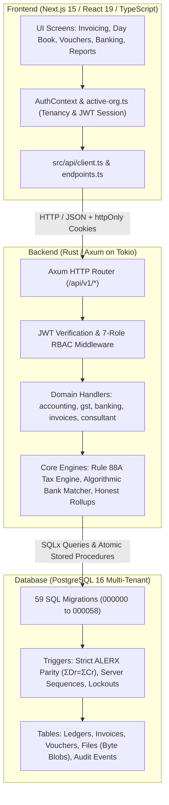

# Deku Finance · Full-Stack Component, Migration & Architecture Map

This document provides a single-table reference mapping **all database migrations**, the **Rust/Axum backend**, and the **Next.js frontend**. It explains what each component contains, why it exists, and how the entire three-tier architecture connects together.

---

## 1. Database Migrations Mapping Table (PostgreSQL)

Below is the complete catalog of all 59 migrations in `supabase/migrations/`, grouped by functional lifecycle.

| Migration File & Sequence | Components Created (Tables, Views, Triggers, Functions) | Why We Need It (Business & Statutory Purpose) | Backend Connection | Frontend Connection |
| :--- | :--- | :--- | :--- | :--- |
| **`000000_platform_auth.sql`** | `auth.users`, password hash helpers, pgcrypto extensions. | Foundation identity store and credential verification. | `backend/src/auth.rs`, `routes/auth.rs` | `src/app/(auth)/login/page.tsx`, `AuthContext.tsx` |
| **`000001_core_identity.sql`** | `user_profiles`, user metadata columns. | Stores user display names, contact details, and account states. | `models/organisation.rs`, `routes/auth.rs` | `src/modules/settings/SettingsView.tsx` |
| **`000002_organisations_tenancy.sql`** | `organisations`, `organisation_memberships`, RLS tenancy policies. | Multitenancy isolation; binds users to legal enterprise workspaces. | `routes/organisations.rs`, `models/organisation.rs` | `CompaniesView.tsx`, `active-org.ts` |
| **`000003_parties.sql`** | `parties` table (customers, vendors), PAN & GSTIN columns. | Central directory of trade counterparties for sales and purchases. | `routes/parties.rs`, `models/party.rs` | `src/modules/masters/parties/`, `VoucherWorkspace.tsx` |
| **`000004_catalogue_items.sql`** | `catalogue_items`, item type enum (Goods/Services), rates, UOM. | Master inventory/service pricing catalogue for auto-completing bill lines. | `routes/catalogue.rs`, `models/catalogue.rs` | `ProductsServicesView.tsx`, invoice catalogue picker |
| **`000005_accounting_foundation.sql`** | `account_groups`, `ledgers`, `sub_ledgers`, `leaf_labels`. | Establishes the 4-tier Indian GAAP accounting hierarchy. | `routes/accounting.rs`, `models/accounting.rs` | `ChartOfAccountsView.tsx`, `ReportDateRange.tsx` |
| **`000006_accounting_posting_reporting.sql`** | `journal_entries`, `journal_lines`, balance check triggers. | Core double-entry ledger enforcing $\sum Dr - \sum Cr = 0$. | `routes/accounting.rs` (`/entries`, `/reports/*`) | `DayBookView.tsx`, `BalanceSheetView.tsx`, `ProfitLossView.tsx` |
| **`000007_sales_invoices_gst.sql`** | `sales_invoices`, `sales_invoice_items`, POS columns, tax math triggers. | Real-time tax invoice generation (Intra-state CGST/SGST vs Inter-state IGST). | `routes/invoices.rs`, `gst/mod.rs` | `DocumentBuilderView.tsx`, `SalesInvoiceEditor.tsx` |
| **`000008_invoice_documents.sql`** | `invoice_documents`, PDF metadata, digital stamp references. | Links generated PDF artifacts and legal bill references to invoices. | `routes/documents.rs`, `routes/files.rs` | PDF download buttons, invoice previews |
| **`000009_audit_events_and_performance.sql`** | `audit_events` table, timestamp indices, RLS security audit. | Append-only security tracking of critical ledger and user state changes. | `routes/audit.rs`, `models/audit.rs` | `AuditTrailView.tsx` |
| **`000010_fix_invoice_issuance_atomic_journal.sql`** | `issue_sales_invoice()` atomic stored procedure. | Ensures creating an invoice atomically posts balancing debits/credits to the ledger. | `routes/invoices.rs` (`/issue`) | `DocumentBuilderView.tsx` (Save & Post) |
| **`000011_alerx_coa_hierarchy.sql`** | ALERX root groups (`Assets`, `Liabilities`, `Equity`, `Revenue`, `Expense`). | Normalizes ledger groups into the five fundamental accounting pillars. | `routes/accounting.rs` | `ChartOfAccountsView.tsx`, `TrialBalanceView.tsx` |
| **`000012_organisation_licenses.sql`** | `organisation_licenses`, license keys, seat count limits, validity dates. | Enforces GO, PRO, and Enterprise licensing entitlements. | `routes/subscriptions.rs` | `PricingPlansSection.tsx`, `entitlements.ts` |
| **`000013_departments_members.sql`** | `departments`, `department_members`, 10 CFO department definitions. | Structuring companies into 10 operating departments for AI CFO intelligence. | `routes/departments.rs`, `routes/consultant.rs` | `DepartmentsMembersView.tsx`, `DekuConsultantView.tsx` |
| **`000014_user_activity_logs_and_security.sql`** | `user_activity_logs`, session trackers, IP recording. | Prevents credential abuse, tracks concurrent logins, records security events. | `routes/audit.rs`, `auth.rs` | Security settings card, admin audit trail |
| **`000015_agentic_memory_core.sql`** | `agentic_memory` (document, event, and accounting memory tables). | Context memory for Deku Consultant AI to analyze historical financial trends. | `routes/consultant.rs` | `DekuConsultantView.tsx` |
| **`000016_superadmin_and_7_role_rbac_matrix.sql`** | 7-role RBAC (`owner`, `admin`, `accountant`, `approver`, `cashier`, `auditor`, `viewer`). | Enterprise permission scoping preventing unauthorized ledger tampering. | `backend/src/auth.rs`, `routes/departments.rs` | Role badges, route guards, button permissions |
| **`000017_universal_financial_rollup_wcm_fpa.sql`** | `compute_wcm_metrics()`, DSO, DPO, Cash Conversion Cycle functions. | Computes Working Capital Metrics directly from ledger balances. | `routes/consultant.rs` | `FpaExecutiveView.tsx`, `WorkingCapitalView.tsx` |
| **`000018_lock_down_function_access.sql`** | `REVOKE EXECUTE ON ALL FUNCTIONS FROM PUBLIC`. | Security hardening: prevents anonymous or unauthorized RPC function execution. | Database security layer | Eliminates client-side security leaks |
| **`000019_bank_reconciliation.sql`** | `bank_transactions`, matching status enum, ledger transaction links. | Allows matching bank statement lines against posted journal entries. | `routes/banking.rs` | `ReconciliationView.tsx` |
| **`000020_journal_approvals.sql`** | `journal_approval_requests`, approval status (`pending`, `approved`, `rejected`). | Maker-Checker workflow: junior vouchers require second-person authorization. | `routes/accounting.rs` (`/approve`, `/reject`) | `ApprovalsView.tsx` |
| **`000021_reports_include_reversed_entries.sql`** | Views for voided/reversed entries with cancellation audit trail. | Preserves historical ledger visibility while netting out voided entries. | `routes/accounting.rs` (`/reports/*`) | General Ledger, Day Book cancelled indicators |
| **`000022_guard_payroll_and_licenses.sql`** | Constraints on payroll disbursement entries and license activations. | Prevents posting negative salaries or duplicate license activations. | `routes/departments.rs`, `routes/subscriptions.rs` | Payroll validation errors, license cards |
| **`000023_honest_wcm_fpa_metrics.sql`** | SQL metric functions returning `NULL` instead of invented/synthetic zero numbers. | Ensures Deku Consultant displays honest dashes (`—`) when ledger data is sparse. | `routes/consultant.rs` | AI CFO metric cards, KPI displays |
| **`000024_purchase_bills.sql`** | `purchase_bills`, `purchase_bill_items`, vendor invoice number, ITC flags. | Inward bill recording with Input Tax Credit eligibility flags. | `routes/purchases.rs` | `PurchasesView.tsx` |
| **`000025_sales_invoice_channel.sql`** | `sales_invoices.channel` column (`direct`, `ecommerce`, `export`). | Separates regular B2B sales from E-Commerce marketplace sales for GST reporting. | `routes/invoices.rs`, `routes/marketplace.rs` | `DocumentBuilderView.tsx`, `MarketplaceView.tsx` |
| **`000026_lock_down_auth_functions.sql`** | Restricts `SECURITY DEFINER` auth triggers and functions. | Hardens user password hashing and token generation routines. | `backend/src/auth.rs` | Login / Signup security protection |
| **`000027_allow_journal_reversal.sql`** | `reverse_journal_entry()` stored procedure. | Generates an immutable countervailing journal entry without deleting history. | `routes/accounting.rs` (`/:id/reverse`) | `DayBookView.tsx` (Reverse Voucher button) |
| **`000028_gst_return_filings.sql`** | `gst_return_filings` (GSTR-1, GSTR-3B preparation tables and status). | Stores filed return summaries, ARN tracking, and period filing timestamps. | `routes/gst.rs` | `GstReturnsView.tsx` |
| **`000029_ledger_functions.sql`** | `get_account_balance()`, `get_running_ledger()`. | High-speed ledger roll-up calculating opening balances, period Dr/Cr, and closing. | `routes/accounting.rs` | `GeneralLedgerView.tsx`, `TrialBalanceView.tsx` |
| **`000030_organisation_profile.sql`** | `organisations.upi_handle`, `pan`, `trade_name`, `state_code`, `msme_reg`. | Legal business identity for invoice headers and dynamic Bharat UPI QR generation. | `routes/organisations.rs` | `SettingsView.tsx`, invoice headers |
| **`000031_sales_notes.sql`** | `sales_notes` table (Credit Notes and Debit Notes), original invoice link. | Statutory credit/debit note issuance with GST Table 9 outward adjustments. | `routes/notes.rs` | `CreditDebitNotesView.tsx` |
| **`000032_invoice_types.sql`** | `invoice_type` enum (`tax_invoice`, `bill_of_supply`, `export_invoice`, `sez`). | Supports dual-mode: pure accounting bills of supply vs statutory B2B tax invoices. | `routes/invoices.rs` | Mode selector on `DocumentBuilderView.tsx` |
| **`000033_hsn_sac_master.sql`** | `hsn_sac_master` table with 15,000+ official Indian GST tariff codes. | Autocomplete directory for 4/6/8-digit HSN/SAC codes with statutory GST rates. | `routes/hsn.rs` | `HsnCombobox.tsx` across invoice lines |
| **`000034_notifications.sql`** | `in_app_notifications`, category, read status, action deep-links. | Real-time alerts for voucher approvals, low stock, and GST filing deadlines. | `routes/notifications.rs` | `NotificationsDropdown.tsx`, Header bell |
| **`000035_marketplace_settlements.sql`** | `marketplace_settlements` table, TCS deductions, logistics recovery. | Reconciles Amazon, Flipkart, Blinkit, and Meesho statements into Table 3.1.1. | `routes/marketplace.rs` | `MarketplaceView.tsx` |
| **`000036_payments_razorpay.sql`** | `payment_links`, `razorpay_orders`, webhook idempotency table. | Online payment collection links and automatic ledger settlement via webhooks. | `routes/payments.rs`, `backend/src/razorpay.rs` | `CollectView.tsx`, `PaymentsCard.tsx` |
| **`000037_gsp_integration.sql`** | `gsp_credentials` (encrypted), ASP/GSP sandbox and live session store. | Direct API tunnel to GST Suvidha Providers for auto-filing and 2B sync. | `routes/gsp.rs`, `backend/src/integrations/gsp.rs` | `GstReturnsView.tsx` (Direct File button) |
| **`000038_kyc.sql`** | `party_kyc_verifications`, GSTIN status, PAN-Aadhaar linking check. | Verifies customer and vendor statutory credentials against government registries. | `routes/kyc.rs`, `backend/src/integrations/kyc.rs` | Party master verification badge |
| **`000039_subscriptions.sql`** | `subscription_plans`, billing history, feature matrix entitlement checks. | Enforces GO, PRO, and Enterprise feature gates and limits in the database. | `routes/subscriptions.rs` | `PricingPlansSection.tsx`, `entitlements.ts` |
| **`000040_invoice_status_guard.sql`** | Trigger preventing deletion or tampering of issued/paid invoices. | Prevents fraud and ensures tax records comply with GST Section 31 rules. | `routes/invoices.rs` | Locked edit state in UI |
| **`000041_membership_bootstrap_and_marketplace_ar.sql`** | Auto-creates first owner membership upon company setup; adds marketplace AR. | Bootstraps company admin without manual SQL and routes marketplace payouts. | `routes/organisations.rs`, `routes/marketplace.rs` | Signup wizard, initial company setup |
| **`000042_inventory.sql`** | `inventory_items`, `stock_ledger_entries`, godown tracking. | Perpetual inventory ledger tracking batch stock movement and cost of sales. | `routes/inventory.rs` | `InventoryView.tsx` |
| **`000043_import_jobs.sql`** | `import_jobs`, staged line items, parse error logs. | Bulk CSV/Excel ETL import engine for Tally XML, parties, vouchers, and HSN. | `routes/imports.rs` | `ImportView.tsx` |
| **`000044_business_documents.sql`** | `proposals`, `quotations`, `purchase_orders`, status lifecycles. | Pre-sales document pipeline converting quotes to sales invoices in 1 click. | `routes/documents_builder.rs` | `DocumentBuilderView.tsx` (Quotes/PO mode) |
| **`000045_reports_exclude_unposted_lines.sql`** | Views filtering out draft, unapproved, or cancelled voucher lines. | Ensures Balance Sheet, P&L, and Trial Balance reflect only committed journals. | `routes/accounting.rs` (`/reports/*`) | All financial report screens |
| **`000046_report_functions_use_chart_columns.sql`** | Uses standardized `account_group` and `classification` columns. | Stabilizes report generation so custom CoA names don't break financial reports. | `routes/accounting.rs` | `BalanceSheetView.tsx`, `ProfitLossView.tsx` |
| **`000047_single_customer_runtime.sql`** | Deployment guard enforcing single-customer isolation per runtime. | Guarantees self-hosted/dedicated instance privacy with single-company lock. | `backend/src/config.rs` | `CompaniesView.tsx` single-tenant flow |
| **`000048_document_files.sql`** | `document_files` table with SHA-256 hash and byte storage in PostgreSQL. | Stores voucher proof documents (receipts, deposit slips, UTRs) inside Postgres. | `routes/files.rs` | Voucher proof upload & preview modal |
| **`000049_login_and_invite_hardening.sql`** | Tracks failed login attempts, lockout duration, and invite tokens. | Protects against brute-force attacks and prevents unauthorized signups. | `backend/src/auth.rs` | Login error banners, invitation flow |
| **`000050_org_chart_and_voucher_numbers.sql`** | Database sequence-driven voucher numbering and org chart reporting table. | Replaces client voucher numbering with gapless, tamper-proof server sequences. | `routes/accounting.rs`, `routes/organisations.rs` | `VoucherWorkspace.tsx`, Org Chart view |
| **`000051_password_reset.sql`** | `password_reset_tokens` table, cryptographic hashes, 24h expiration. | Allows admin-controlled password resets without requiring SMTP/email infrastructure. | `backend/src/routes/auth.rs` | `src/app/(auth)/reset-password/page.tsx` |
| **`000052_bank_name_and_cfo_reconciliation.sql`** | Resolves bank names from IFSC codes and links bank lines to CFO recon. | Enhances statement parser with official Indian bank identities. | `routes/banking.rs`, `routes/consultant.rs` | Bank statement upload card |
| **`000053_neutral_bank_ledger_name.sql`** | Eliminates hardcoded bank names in favor of neutral configured accounts. | Ensures bank accounts flexibly match any user-specified bank or branch. | `routes/banking.rs` | `ChartOfAccountsView.tsx` |
| **`000054_report_date_ranges.sql`** | Parameterized report functions accepting `start_date` and `end_date`. | Enables custom fiscal period filtering across P&L, Balance Sheet, and Day Book. | `routes/accounting.rs` | `ReportDateRange.tsx` component |
| **`000055_edit_draft_journal.sql`** | `update_draft_journal_entry()` procedure with balancing re-validation. | Allows editing draft voucher lines before posting while enforcing parity. | `routes/accounting.rs` (`/drafts/:id`) | `EditDraftModal.tsx` in Day Book |
| **`000056_reconciliation_statements.sql`** | `reconciliation_statements`, statement balance vs ledger variance. | Permanent audit record of monthly bank reconciliations and signed statements. | `routes/banking.rs` | `ReconciliationView.tsx`, `/reconciliation` |
| **`000057_employee_pay_privacy.sql`** | RLS policy restricting payroll compensation data to Owner and CFO roles. | Prevents junior staff and accountants from inspecting colleagues' salaries. | `routes/departments.rs` | Masked payroll view in Departments |
| **`000058_payroll_posts_to_ledger.sql`** | `post_payroll_run_to_ledger()` atomic stored procedure. | Automatically posts balanced salary expense and TDS deduction journals upon payroll run. | `routes/departments.rs` (`/payroll/post`) | 1-Click "Post to Ledger" in Payroll |

---

## 2. Backend Architecture Mapping Table (Rust / Axum)

The backend is built in **Rust** using the **Axum** web framework, running on Tokio async runtime with SQLx/PostgREST connectivity.

| Backend File / Module | Key Endpoints Exposed | Why We Need It (Operational Purpose) | Database Migrations Connected | Frontend Modules Connected |
| :--- | :--- | :--- | :--- | :--- |
| **`auth.rs` & `routes/auth.rs`** | `POST /api/v1/auth/login` `POST /api/v1/auth/signup` `POST /api/v1/auth/refresh` `POST /api/v1/auth/password/reset` | Authenticates users, issues signed JWTs with `httpOnly` secure cookies, enforces lockout, and manages password resets. | `000000`, `000001`, `000016`, `000049`, `000051` | `login/page.tsx`, `reset-password/page.tsx`, `AuthContext.tsx` |
| **`routes/accounting.rs`** | `GET/POST /api/v1/organisations/:id/entries` `GET /api/v1/organisations/:id/reports/balance-sheet` `GET /api/v1/organisations/:id/reports/profit-and-loss` `GET /api/v1/organisations/:id/reports/trial-balance` `PATCH /api/v1/organisations/:id/entries/drafts/:entryId` | Core accounting desk: posts balanced journals, serves financial reports with custom date ranges, and handles draft voucher edits. | `000005`, `000006`, `000010`, `000011`, `000020`, `000027`, `000045`, `000046`, `000050`, `000054`, `000055` | `VoucherWorkspace.tsx`, `DayBookView.tsx`, `EditDraftModal.tsx`, `BalanceSheetView.tsx`, `ProfitLossView.tsx`, `TrialBalanceView.tsx` |
| **`gst/mod.rs` & `routes/gst.rs`** | `POST /api/v1/organisations/:id/gst/gstr1/compile` `POST /api/v1/organisations/:id/gst/gstr3b/calculate` `GET /api/v1/organisations/:id/gst/returns` | Computes intra/inter-state tax math, optimizes ITC set-off under Rule 88A, and compiles official GSTR-1/3B offline JSON. | `000007`, `000028`, `000032`, `000033` | `GstReturnsView.tsx`, `SalesInvoiceEditor.tsx` |
| **`routes/banking.rs`** | `POST /api/v1/organisations/:id/banking/statements/upload` `POST /api/v1/organisations/:id/banking/reconcile/match` `GET /api/v1/organisations/:id/banking/statements` | Ingests CSV/Excel statements, runs the algorithmic match engine against ledger entries, and saves reconciled statements. | `000019`, `000052`, `000053`, `000056` | `ReconciliationView.tsx`, `src/app/reconciliation/page.tsx` |
| **`routes/invoices.rs`** | `GET/POST /api/v1/organisations/:id/invoices` `POST /api/v1/organisations/:id/invoices/:id/issue` `GET /api/v1/organisations/:id/invoices/:id/pdf` | Manages sales invoice lifecycles, calculates place-of-supply taxes, atomic ledger posting, and generates high-DPI PDFs. | `000007`, `000008`, `000010`, `000025`, `000030`, `000040` | `DocumentBuilderView.tsx`, `SalesInvoiceEditor.tsx`, `InvoicesList.tsx` |
| **`routes/purchases.rs`** | `GET/POST /api/v1/organisations/:id/purchases` `POST /api/v1/organisations/:id/purchases/:id/post` | Inward vendor bill management, ITC classification (eligible vs Section 17(5) blocked), and purchase ledger posting. | `000006`, `000024` | `PurchasesView.tsx` |
| **`routes/notes.rs`** | `GET/POST /api/v1/organisations/:id/notes` (Credit/Debit) | Issues statutory Credit and Debit notes with original invoice links for outward tax adjustments. | `000006`, `000031` | `CreditDebitNotesView.tsx` |
| **`routes/consultant.rs`** | `GET /api/v1/organisations/:id/consultant/metrics` `POST /api/v1/organisations/:id/consultant/query` | Serves Deku Consultant AI CFO metrics across 10 departments; guarantees zero hallucinated numbers via honest SQL rollups. | `000013`, `000015`, `000017`, `000023` | `DekuConsultantView.tsx`, `FpaExecutiveView.tsx` |
| **`routes/departments.rs`** | `GET /api/v1/organisations/:id/departments` `POST /api/v1/organisations/:id/departments/:id/members` `POST /api/v1/organisations/:id/departments/payroll/post` | Manages organization chart, employee directory, masked compensation data, and automated payroll ledger posting. | `000013`, `000016`, `000022`, `000057`, `000058` | `DepartmentsMembersView.tsx` |
| **`routes/organisations.rs`** | `GET /api/v1/organisations` `PATCH /api/v1/organisations/:id/profile` `POST /api/v1/organisations/bootstrap` | Configures company profile, trade name, GSTIN, Bharat UPI VPA, and single-customer runtime setup. | `000002`, `000030`, `000041`, `000047`, `000050` | `SettingsView.tsx`, `CompaniesView.tsx`, onboarding wizard |
| **`routes/parties.rs`** | `GET/POST /api/v1/organisations/:id/parties` `GET/PATCH /api/v1/organisations/:id/parties/:id` | Manages trade customers and suppliers, verifies GSTIN check digits, and tracks party outstanding balances. | `000003`, `000038` | `PartiesView.tsx`, party selectors |
| **`routes/catalogue.rs` & `routes/hsn.rs`** | `GET/POST /api/v1/catalogue/items` `GET /api/v1/hsn/search` | Master item catalogue and fast substring search across 15,000+ official Indian HSN/SAC codes. | `000004`, `000033`, `000042` | `ProductsServicesView.tsx`, `HsnCombobox.tsx` |
| **`routes/audit.rs`** | `GET /api/v1/organisations/:id/audit/events` | Serves tamper-evident, chronologically merged security events and ledger audit logs. | `000009`, `000014` | `AuditTrailView.tsx` |
| **`routes/files.rs`** | `POST /api/v1/organisations/:id/files/upload` `GET /api/v1/organisations/:id/files/:id` | Safely stores and streams voucher proof documents (receipts, deposit slips) stored as byte blobs in PostgreSQL. | `000048` | Voucher workspace proof file attachment |
| **`routes/marketplace.rs`** | `POST /api/v1/organisations/:id/marketplace/settlements/parse` | Ingests bulk settlement CSVs from Amazon, Flipkart, Blinkit, and Meesho; posts commissions and TCS. | `000025`, `000035`, `000041` | `MarketplaceView.tsx` |
| **`routes/payments.rs` & `razorpay.rs`** | `POST /api/v1/payments/links/create` `POST /api/v1/payments/razorpay/webhook` | Creates payment links with dynamic UPI QR and verifies HMAC webhook signatures for auto-settlement. | `000036` | `CollectView.tsx`, `PaymentsCard.tsx` |
| **`integrations/gsp.rs` & `kyc.rs`** | `POST /api/v1/integrations/gsp/file` `POST /api/v1/integrations/kyc/verify` | Connects to GST Suvidha Provider and government KYC registries (with labelled sandbox fallback). | `000037`, `000038` | `GstReturnsView.tsx`, Party KYC badge |
| **`routes/imports.rs`** | `POST /api/v1/imports/start` `GET /api/v1/imports/:id/status` | Staged ETL import engine parsing Tally XML, parties, vouchers, and transactions. | `000043` | `ImportView.tsx` |

---

## 3. Frontend Architecture Mapping Table (Next.js / TypeScript)

The client application is built with **Next.js 15 (App Router)**, **React 19**, and **Tailwind CSS**, fully typed in TypeScript.

| Frontend Module & Route | Primary Components | Why We Need It (User Capability) | Backend API Connected | Underlying DB Migrations |
| :--- | :--- | :--- | :--- | :--- |
| **Gateway of Deku (`/gateway`)** | `GatewayLanding.tsx`, `QuickActions.tsx`, `LedgerMetrics.tsx` | Central mission control: displays live liquidity, quick keyboard shortcuts (<kbd>Alt+G</kbd>), and turnover gauge. | `GET /reports/*`, `GET /organisations/:id` | `000002`, `000006`, `000030`, `000050` |
| **Invoicing & Builder (`/builder`, `/invoices`)** | `DocumentBuilderView.tsx`, `SalesInvoiceEditor.tsx`, `HsnCombobox.tsx` | High-speed billing desk for issuing B2B Tax Invoices, Bills of Supply, dynamic Bharat UPI QR, and IRN E-Invoices. | `POST /invoices`, `GET /catalogue`, `GET /hsn` | `000004`, `000007`, `000010`, `000030`, `000032`, `000033` |
| **Voucher Desk (`/vouchers`)** | `VoucherWorkspace.tsx`, `ProofUploadModal.tsx` | Tally-style F-key desk (<kbd>F4</kbd>–<kbd>F9</kbd>) for posting Contra, Payment, Receipt, and Journal vouchers with proof attachments. | `POST /entries`, `POST /files/upload` | `000005`, `000006`, `000011`, `000048`, `000050` |
| **Day Book (`/day-book`)** | `DayBookView.tsx`, `EditDraftModal.tsx` | Chronological transaction feed with server-issued voucher sequences, draft in-line editing, and 1-click reversals. | `GET /entries`, `PATCH /entries/drafts/:id`, `POST /entries/:id/reverse` | `000006`, `000027`, `000045`, `000050`, `000055` |
| **Approvals Desk (`/approvals`)** | `ApprovalsView.tsx`, `ApprovalDecisionModal.tsx` | Maker-Checker review portal: CFOs and managers review, authorize, or reject junior accountants' pending vouchers. | `GET /approvals`, `POST /approvals/:id/decide` | `000016`, `000020` |
| **General Ledger (`/reports/general-ledger`)** | `GeneralLedgerView.tsx`, `ReportDateRange.tsx` | Deep account-level drill-down showing running debit/credit balances, opening/closing figures, and CSV statement exports. | `GET /reports/general-ledger?from=&to=` | `000005`, `000006`, `000029`, `000054` |
| **Financial Statements (`/reports/*`)** | `BalanceSheetView.tsx`, `ProfitLossView.tsx`, `TrialBalanceView.tsx` | Real-time Indian GAAP statements driven by mathematical double-entry invariants with custom date range filters. | `GET /reports/balance-sheet`, `GET /reports/profit-and-loss`, `GET /reports/trial-balance` | `000005`, `000006`, `000011`, `000045`, `000046`, `000054` |
| **Banking & Reconciliation (`/banking`, `/reconciliation`)** | `ReconciliationView.tsx`, `StatementUploadZone.tsx` | Uploads CSV bank statements, executes algorithmic matching against ledger legs, and generates signed monthly statements. | `POST /banking/statements/upload`, `POST /banking/reconcile/match` | `000019`, `000052`, `000053`, `000056` |
| **GST Returns Hub (`/gst/returns`)** | `GstReturnsView.tsx`, `Gstr1Table.tsx`, `Gstr3bSummary.tsx` | 1-Click compiler for official GSTR-1 offline JSON and GSTR-3B tax calculations with Rule 88A optimal ITC set-off. | `POST /gst/gstr1/compile`, `POST /gst/gstr3b/calculate` | `000007`, `000028`, `000037` |
| **Deku Consultant AI CFO (`/consultant`, `/executive`)** | `DekuConsultantView.tsx`, `FpaExecutiveView.tsx` | Virtual AI CFO covering 10 departments; analyzes working capital, runway, and expense anomalies with honest data. | `GET /consultant/metrics`, `POST /consultant/query` | `000013`, `000015`, `000017`, `000023` |
| **Departments & Members (`/departments-members`)** | `DepartmentsMembersView.tsx`, `PayrollRunModal.tsx` | Organization structure, employee directory, confidential payroll compensation masking, and automated ledger posting. | `GET /departments`, `POST /departments/payroll/post` | `000013`, `000016`, `000057`, `000058` |
| **Parties & Masters (`/masters/*`, `/parties`)** | `PartiesView.tsx`, `ProductsServicesView.tsx`, `HsnCombobox.tsx` | Customer and vendor master records with GSTIN check digit validation, and products catalogue with linked revenue ledgers. | `GET/POST /parties`, `GET/POST /catalogue/items` | `000003`, `000004`, `000033`, `000038`, `000042` |
| **Help Centre & Learning (`/help`, Modal)** | `HelpCentreView.tsx`, `TutorialCoach.tsx`, `InteractivePlanTutorialModal.tsx` | In-app documentation, 9 structured learning paths, plan-wise module comparison (GO, PRO, Enterprise), and invoice simulator. | Client-side tutorial state & demo auth | `000012`, `000039` |
| **Settings & Security (`/settings`, `/reset-password`)** | `SettingsView.tsx`, `ChangePasswordCard.tsx`, `AuditTrailView.tsx` | Company profile (UPI VPA, PAN, GSTIN), user password changes, admin reset links, and SHA-256 audit log inspection. | `PATCH /organisations/:id/profile`, `POST /auth/password` | `000009`, `000014`, `000030`, `000051` |
| **Authentication & Demo (`/login`, `/signup`)** | `login/page.tsx`, `signup/page.tsx`, `PricingPlansSection.tsx` | Enterprise authentication, admin bootstrap, instant demo sandbox logins (GO vs PRO), and Annual Contract Licensing tables. | `POST /auth/login`, `GET /api/auth/demo` | `000000`, `000001`, `000012`, `000016`, `000047`, `000049` |

---

## 4. Architectural Data Flow: How Everything Connects

---

### Summary of Platform Guarantees
1. **Mathematical Invariant**: Trigger-enforced double-entry parity ($\sum Dr - \sum Cr = 0$) prevents corrupt or unbalanced entries.
2. **Honest Data Rule**: Zero synthetic or hallucinated figures—missing figures render as clean dashes (`—`).
3. **Statutory Alignment**: Strict Indian GST Act adherence (Section 22 Exemption, Rule 88A optimal set-off, GSTR-1 & GSTR-3B offline JSON, IRP INV-01 IRN hash, and Section 43B(h) MSME recovery).
4. **Single-Tenant Privacy**: Dedicated single-customer runtime isolation preventing cross-organization data leakage.

